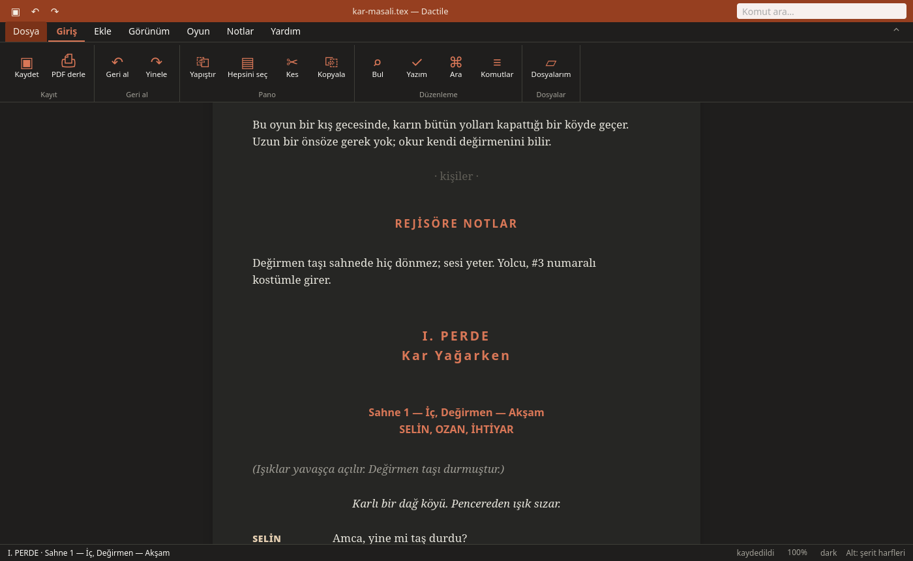
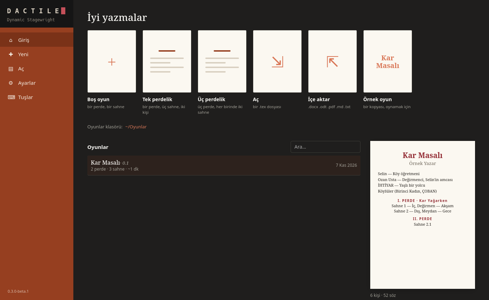
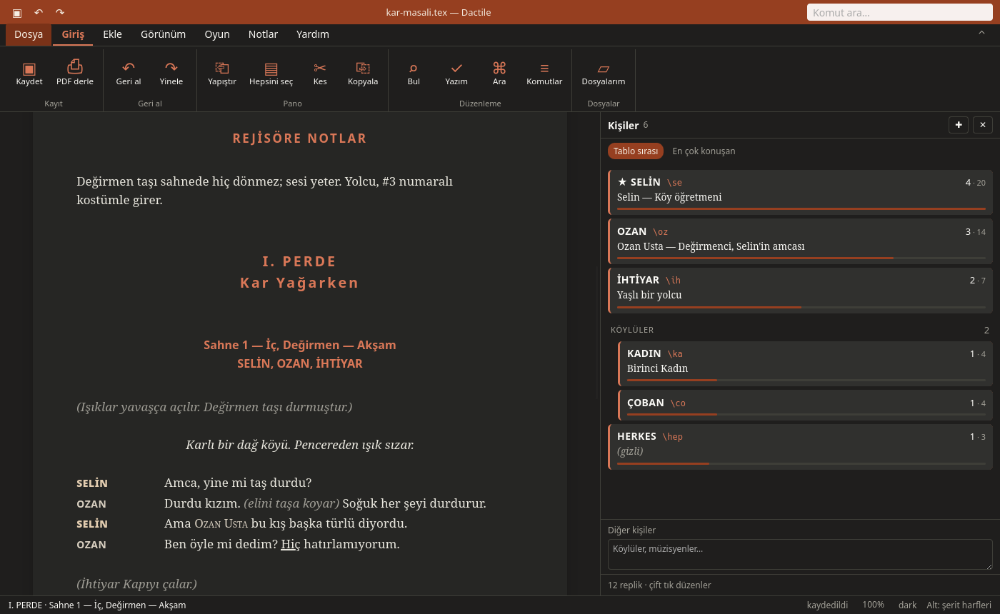

# Dactile — Dynamic Stagewright

[Türkçe](README.tr.md)

Dactile is an app for writing stage plays, and Dactile Light is the same writer
in a terminal. You write the play in the syntax of the **tiyatro** XeLaTeX class, and the macros come alive as you type: `\se Amca`
turns into `SELİN   Amca` on the spot, `\sahne` asks for a place and a time
and opens a numbered scene, and the characters who appear in a scene gather
under its heading by themselves.

The file stays a plain `.tex` that compiles with XeLaTeX, so a play written in
Dactile still opens in any TeX editor, and Dactile opens plays written
elsewhere.



> Beta. Every change is an edit of the text itself, saved atomically, with
> earlier versions kept; but the app is new, so keep a copy of anything
> precious.

```latex
\karakter*[Selin][Köy öğretmeni]{SELİN}{se}
\karakter[Ozan Usta][Değirmenci]{OZAN}{oz}

#perde Kar Yağarken
#sahne İç, Değirmen — Akşam

\se Amca, yine mi taş durdu?
\oz Durdu kızım. \ic{elini taşa koyar} Soğuk her şeyi durdurur.
\sedo\ozdo Birbirlerine bakarlar.
```

See [examples/ornek-oyun.tex](examples/ornek-oyun.tex) for every feature, and
[the documentation](docs/README.md) for a guide to all of it.

## Install

On Linux, from [Releases](https://github.com/D4shwood/dactile/releases):

```sh
chmod +x Dactile-*-x86_64.AppImage
./Dactile-*-x86_64.AppImage
```

On Arch, the AUR's `dactile-bin` gives the `dactile` command, a menu entry
and Dactile Light.

From source, it needs WebKitGTK and Node.js: in `app/`, `npm install`, then
`npm run tauri dev`.

**Dactile Light** is the same writer in a terminal:

```sh
tar xzf dactile-light-*-x86_64-linux.tar.gz
cd dactile-light-*-x86_64-linux
./dactile-light install
```

`dactile-light install` puts the `dactile-light` command in `~/.local/bin`,
adds a menu entry with its icon, and copies the tiyatro class into your TeX tree
(`~/texmf`), so plays compile from any folder. `dactile-light uninstall`
removes all three; your plays and settings stay. From source:
`cargo install --path tui`, then `dactile-light install`.

Before 0.3 Dactile Light was the `dactile` command: `dactile uninstall`
removes that one.

- **Spell checking** needs a Turkish Hunspell dictionary (`tr_TR.aff` and
  `tr_TR.dic`) in `~/.local/share/hunspell` or `/usr/share/hunspell`; on
  Arch, `paru -S hunspell-tr`. Without one, everything else works.
- **PDFs** need XeLaTeX (`texlive-xetex` and `texlive-latexextra`, or a full
  TeX Live).

## Using it

This page describes Dactile Light's keys and screens; Dactile has the
same plays and tools on a page, with a ribbon and the mouse. On its start
screen Shift and Ctrl choose several plays and a right click gives a play's
options. Its themes are the same five, with a sixth button, Surprise me, that
makes new colours at every press.

```sh
dactile-light                   # the home screen: your plays, a new one, settings
dactile-light oyun.tex          # straight into a play
dactile-light new "Kar Masalı"  # a new play in a folder of its own
dactile-light import oyun.docx  # a play made of a document (see Importing)
```

The first run asks for the language (Turkish or English), the folder your
plays live in, your name, and how the suggestion menu opens.



The home screen is laid out like a word processor's start screen. A column
on the left goes to Giriş (home), Yeni (new), Aç (open), Ayarlar (settings)
and Tuşlar (keys); Tab moves between it, the tiles and the list, and the
mouse works too. Over your plays a row of tiles starts a new one: an empty
play, a one-act or a three-act skeleton, opening or importing a file, or a
copy of the example play. Yeni (`n`) shows every template: those four, a
monologue, a short sketch, and your own. In the writer, File › Save as a
template keeps a play's cover, cast, acts and scenes, without its lines, in
`~/.config/dactile/templates`; `d` under Yeni sends one of yours to the trash.

On the home screen `d` copies the chosen play under a new title, and `f`
starts a new draft of it next to it (`kar-masali-0.2.tex`, the draft number
one up, the character cards along). Drafts stack up above the play they came
from as a tree, the newest on top, and the home screen opens on the play you
worked on last. F2 renames a play right in its row, as a file manager does:
type the new title, and its file, and the files that go with it, follow (a
draft keeps its number at the end of its file name). Shift+F2 gives the title
and the file name separately. `p` opens its PDF. Del, pressed twice, sends
it to the desktop's trash, and `u` brings it back; `?` lists every key.
Beside the list stands the chosen play's first page, as tall as the screen,
laid out as the writer lays it out, in the writer's theme. Under the list,
level with the page's foot: the play as a strip of its scenes, each as long
as it plays, then its scenes with their times and who speaks how much.

| Type | You get |
|---|---|
| `\se ` (an alias and a space) | a line for SELİN; an alias nobody declared opens the new-character form |
| `\sedo ` | a direction, `(Selin …)`, with the verbs this play uses most |
| `\` | the suggestion menu: characters (those in the scene first), commands, macros |
| `#` at a line's start | the headings: `#sahne`, `#önsahne` (a prologue), `#perde`, `#önsöz` (a preface), `#notlar` (notes for the director) |
| `#sahne İç, Değirmen — Akşam` | a scene, typed straight; choosing it from the `#` menu asks for place and time |
| `SELİN:` at a line's start | a line for SELİN (any of her names, any case); an unknown name in capitals opens the new-character form |
| Tab on an empty line | who speaks next, shown faint: the one before the last speaker |
| `((` | a direction inside a line, `\ic{…}` |
| ^V at a line's start | a draft pasted from elsewhere: `NAME: …` lines become lines, `(…)` lines directions, `#…` lines headings |

A macro is a chip: the cursor steps over it, and Backspace into it shows the
line's source until you leave it. F2 shows the whole play as source.

The page reads like the PDF, the curtain at the end of an act; F7 cuts it
into A4 sheets where the PDF starts a new page (the cover, the preface, the
cast table, each act) and where a sheet fills up, with page numbers. On a wide
screen the play's outline sits in the margin; a click goes there.

| Key | |
|---|---|
| F10 | the ribbon along the top, as in a word processor: tabs (File, Home, Insert, View, Play, Notes, Help) and their buttons in groups; F10 shows a letter on each tab, then on each button (F10 N A puts in a stage direction), the arrows work too, and the mouse. File opens a page of its own: the play's details, PDF, copies, templates. ^F1 folds the ribbon to its tabs |
| ^P | the command palette: everything by name — new scene, themes, page view, animations… |
| ^O | the cast: edit, rename an alias everywhere, order, character cards; m merges one into another, b splits one, giving the scenes you pick to a new character; g a new group (with its members), t moves a character into a group or out of one, and on a group n adds a member, e renames it, d dissolves it |
| ^N, Alt+N | notes beside the writing (below); a note on the selection or the word at the cursor |
| ^G, ^G ^G | the scene strip beside the writing; twice quickly, the board (below) |
| F9 | casting: who plays whom, the scene/role table, the numbers (below) |
| Alt+E, Alt+B, Alt+J | the cursor's scene's summary; split the scene at the cursor's line; join it with the next |
| ^K | search characters and commands |
| ^F | find and replace |
| Alt+I | cover details (title, author, draft number…) and draft/final |
| Alt+S | spelling suggestions for the word at the cursor |
| Alt+P | show the cast and cover lines of the source |
| F5, Alt+O, Alt+L | build the PDF next to the play (in the background, one XeLaTeX run); open it in the viewer. What would stop XeLaTeX is underlined faintly as you write (the cursor on it says what); `&`, `$`, `^`, a stray `_` and `%50` are escaped quietly on save; a brace left open or a command nobody defined stops F5 there, and F5 again builds anyway; if XeLaTeX still fails, Alt+L opens its log |
| F3 / F4 / F8 | typewriter, scene focus, dim the rest |
| Shift+F8 | role view: the cursor's role lit, the rest faint |
| F6 | the theme: paper, sepia, night, high contrast, dark |
| F7 | page view: A4 sheets broken where the PDF breaks, numbered |
| ^Z ^Y, ^C ^X ^V | undo, redo, copy, cut, paste |
| ^S, ^Q | save (it saves by itself anyway), quit |
| F1 | a keyboard: press any key to see what it does |



### The board

^G opens a strip beside the writing: the acts and scenes, the cursor's scene
lit and open, with its summary, its length and who is in it. It steps aside
when the screen is too narrow for the page and it. ^G twice quickly opens the
board, full screen, as a list or (Tab) as cards: the acts as columns, the
scenes as cards with place, length, cast and summary.

- ⏎ goes to the scene; `e` writes its summary (a line or two, never printed,
  shown faint under the heading in the writer too; Alt+E there).
- Alt+↑↓ moves the scene a place, over an act's edge into the next one;
  Alt+←→ on the cards to the act before or after. `m` picks it up, the arrows
  choose where, ⏎ puts it down. Acts move whole, the marked ones (␣) together.
  Each move is one undo.
- `j` joins the scene with the next: the second heading becomes a direction
  with its place. Alt+B in the writer splits a scene at the cursor's line.
- `n` opens a new card: a hidden scene (`%~`), out of the PDF until ⏎ opens it
  to write in.
- `h` hides (as `%~` lines), `t` moves to the play's trash, `c` shows the
  trash: r puts back, x x destroys.

Before the first move, split or join of a session the play as it was is kept
as a draft beside it (`oyun-0.2.tex`); you go on in the play itself. A scene
with a summary carries a short id at its heading's end, `#sahne Meydan %@k3`,
which the PDF never sees: the summary follows the scene wherever it goes.

### Casting

F9 opens who plays whom, full screen, in three views (Tab):

- **casting**: the roles, each with its actor (⏎ to write one in), its lines,
  words, time and scenes. A play can have several castings, an A and a B
  lineup: ←→ between them, `n` a new one (a copy of this one), `r` renames,
  `x` deletes. `k` builds a copy for each actor, and for each role nobody
  is cast in yet (`ROLE.pdf`): 1 full, 2 rehearsal, 3 rehearsal light;
  `z` memorizes the role.
- **table**: the scenes down, the roles across, ● where a role speaks and ○
  where it is on stage without a line; ⏎ goes to the scene, `x` writes it as
  CSV (`oyun-tablo.csv`), `p` as a landscape PDF (`oyun-tablo.pdf`).
- **numbers**: lines, words, time and share by role, scene and act lengths;
  `w` sets the play's pace in words a minute.

An actor's copy (`oyun-kopyalar/Actor (ROLE).pdf`) has their lines in bold
and the rest whole but faint, their entrances and exits in bold, the scenes
they are not in down to their headings, and a cover with their name, their
scenes with pages, and how much they say. A rehearsal copy (`… - prova.pdf`)
keeps who speaks when but leaves the others' words out, with room for notes
where they were, so the actor rehearses without reading them; the light one
keeps the first one to three words of each (the same every time). `o` opens the last table or
copies. Actors' names stay in the sidecar; the play's own PDF never shows
them.

Memorizing (`z` on F9, or "Memorize" on ^P for the cursor's role) shows the
cues before each of the role's lines and hides the line: Space shows the
first letters of its words, Space again all of it, then the next one.

Next to a play Dactile keeps `oyun.dactile.toml`, with the character cards,
the scene summaries, the castings and the play's own words for the spell
checker (the PDF never sees it), and
`.oyun.tex.dactile-lock` while the play is open, so a second Dactile opens it
read-only. Earlier versions go to `~/.local/share/dactile/history`.

### Importing

`i` on the home screen opens the desktop's file chooser (where there is
none, over SSH say, it asks for a path) for a play written elsewhere: a Word
`.docx`, a LibreOffice `.odt`, a PDF with text in it, Markdown or plain
text. Nothing else needs installing: Dactile carries Tesseract and
Poppler's tools. A scanned PDF is read from its page images by itself, and
"Read again with OCR" in the preview does so for a PDF whose text is poor;
`dactile-light import --ocr` does the same where Tesseract with Turkish is
installed. Dactile Light reads a PDF better where `pdftotext` is there.

A volume of several plays is told by its contents and title pages, or, without
them, by who speaks; a play found that way is marked as a guess. The volume
opens on a list of its plays with their pages, lines and people: choose those
to take and make them together (`--all` on the command line, `--play` for one).
A play found wrongly goes back into the one before it, and a new one can be
started by hand at any paragraph.

Plays made together can stand under one book (`--book TITLE`), a tree on
Dactile's start screen, and the pages around them can come in too (`--front`).
The book builds as one PDF with a cover and contents, each play in it
(`dactile-light book kitap.tex`).

A cast page the reading gets wrong can be chosen by hand, and the list put
right as text, a person a line:

```text
NAME | a note on them
NAME ON THE LIST = NAME OVER THE LINES | note
\chargroup The group's name
\gkarakter NAME | note
+ those named only in a group
# a comment
```

Where a PDF sets its directions in italics, they are read as directions, and
a list of who first played the parts gives the characters without the actors.

Dactile finds the title and author, a cast list (`KİŞİLER`, `CHARACTERS`)
with what it says of each, act and scene headings (`BİRİNCİ PERDE`,
`2. Sahne: Ahır`, `ACT ONE`), a preface and notes, and lines of dialogue
written `NAME: …`, `NAME — …`, `NAME. …` or with the name on a line of its
own above them. A paragraph in parentheses, or all in italics, is a
direction, and inside a line `(laughing)` or words in italics are an inline
one. In a PDF the running heads, page numbers and margin line numbers go,
and lines the page broke are joined; short ones stay as in a poem. A name
OCR misread is put as the book spells it most, a speaker's spelling is joined
to the name it comes from on the cast page, those the cast page lists without
names go under the list, and a footnote goes where the page marks it.

Before the play is written a preview lists the names found, with how many
lines each has and the first of them: `e` changes a name, `a` its alias, `m`
merges two that are the same person (and splits them again), `x` marks one
that is not a character at all (`NOT: …`), whose lines stay as text, and `t`
the title and author. ⏎ writes the play to a folder of its own in your plays folder and opens it.
`dactile-light import FILE` does the same from the command line, taking the names
as they come. A scanned PDF, pictures of pages, needs OCR first.

A play in a book comes with what a publisher puts around it: the cover, the
imprint, the contents, a foreword, the author's life. The play is found by
where people answer each other, and only that part is read for who speaks;
in a PDF, page 1 after Roman numerals says where it starts. In
Dactile's preview you see the whole document: click a paragraph or a part (Shift
for many, F3 for the next), mark it, or say the play starts or ends there. A
foreword and notes stay, as the play's own sections.

### Notes

Notes on the play from anyone — an AI's review, a workshop, a reader, your
own — live beside it in `oyun.notlar.md`, a Markdown task list any editor
(Obsidian too) reads and writes:

```text
## Spelling

- [ ] 139 · **Claude** · “Gaztesi” → Gazetesi
  - **Deniz**: the same in act two
- [x] 20 · **Workshop** · “loş bir bir ışığın”: “bir” twice
```

`[ ]` is open, `[x]` done, `[-]` hidden; what is under `## Archive: …` is
archived. The number is a line of the play; a note finds its place again by
what it quotes, so lines added above it don't lose it, and on save its number
follows.

^N opens the notes on the right: ↑↓ goes from one to the next, the text
moving to its place, lit; Esc goes back to the text with the panel open, ^N
again closes it. Open notes are underlined in the text in their author's
colour, with a dot in the margin. In the panel:

| Key | |
|---|---|
| p | paste a reply (an AI's, a reader's mail): each numbered item (`139: …`, `- 20: …`, `• 68 (newspaper): …`) is a note, a short line before a run of them their heading; it asks who they are from |
| i | take a file of notes, `.md` or `.txt`, the same way (or one in Dactile's own form) |
| n | a note of your own on the selection or the word at the cursor (Alt+N from the text) |
| ␣ | done, struck through, or open again |
| u | make the note's correction, `“wrong” → right`: only the words that differ change, ^Z undoes it, the note is done |
| r, e | reply to it; edit it, its line and its replies |
| h, a, x | hide it, archive it, delete it (x twice) |
| f, s | only one author's notes; the done, hidden and archived ones too |
| c, o | a PDF copy with the open notes in its margin, numbered, each in its author's colour, and all of them with their replies at the end (`oyun - notlu.pdf`); open it |

When what a note quotes is gone from the text, the panel says it looks fixed;
ticking it is yours. Nothing changes the play by itself.

## The tiyatro class

[tex/](tex/) holds the class, which Dactile carries inside itself:

- characters with aliases: `\karakter`, groups (`\karaktergrubu` or
  `\chargroup`, their members `\gkarakter`), characters
  left out of the cast table (`\secretcharacter`), and the name used inside a
  line (`\setinlinename`), and those the cast page doesn't name, under the
  list (`\digerkisiler{Köylüler, müzisyenler.}`, or `\othercast`)
- footnotes in lines and directions: `\dipnot{…}`, or `\footnote`
- a line of dialogue runs on over the source lines under it, each one a line
  of its own in print, up to a blank line or a line that starts with a
  command or a `#`; the name is in a column of its own, and a `%` at the end
  of a line joins the next one to it
- directions: `\aliasdo` chains, `\action`, `\stagedir`, `\middir`, `\ic`, `\beat`;
  entrances and exits, `\girer{se,oz}` → (SELİN ile OZAN girerler.), `\cikar{se}`
- acts and scenes with automatic numbers. Each scene heading lists who appears
  in it; this needs a second run.
- headings as `#` lines: `#perde Title`, `#sahne Place — Time`,
  `#sahne[2.1] Place`, `#önsöz`, `#notlar` (also `#act`, `#scene`, `#preface`,
  `#notes`). `\#` prints a `#`; `\perde[…]` and `\sahne[…]` work as before.
- a prologue: `#önsahne Place` (or `#prologue`, `\onsahne[Place]`) prints an
  unnumbered "Ön Sahne" heading; the next `#sahne` is still Scene 1.
- a preface (`\onsoz`) and notes for the director (`\notlar`), each on a page
  of its own
- the cast table (`\kisiler`) and a cover
- **draft** and **final** modes:

  | Mode | Font | Spacing | Margin | Cover |
  |---|---|---|---|---|
  | draft | serif | 1.15× | one number per line of dialogue or direction | "TASLAK" |
  | final | serif | single | none | the starred characters |

- `\scenetitleflush[left]` in the preamble sets the scene headings to a side
  (`right`, or `center`, the default).
- options: `nohash` makes `#` an ordinary character again; `nonotes` leaves the
  director's notes out of a copy. A `#` line ends at the end of the source
  line, or at a `%` comment on it.
- actor copies, written by Dactile into a copy of the play's preamble:
  `\tiyatrocopy{se}{Actor}` puts that role's lines in bold and fades the
  rest (the `xcolor` package), `\tiyatromark` before a direction makes it
  bold, `\tiyatrocopycover{…}` adds to the cover, `\tiyatrogap{n}` leaves n
  lines' room where a line's words were.
- a copy with notes: `\tiyatronotes` in the preamble widens the right
  margin, `\tiyatronote{RRGGBB}{Who}{n}{text}` puts note n there beside its
  line, `\tiyatronoted{RRGGBB}{words}` colours what it is about, and
  `\tiyatronoteslist{Title}{…}` lists them all after the end, with
  `\tiyatronoteitem` and `\tiyatronotereply`.

```sh
xelatex oyun.tex
```

Who is in each scene, under its heading, the class only learns at the scene's
end, so it keeps the casts in the `.aux` for the next run. Dactile writes them
there before each F5, and on every save once there is an `.aux`, so one run is
enough; after editing elsewhere, the class
warns "Rerun to get them right", and a second run fixes it.

The class grew out of [tiyatro-latex](https://github.com/D4shwood/tiyatro-latex)
and was rewritten for Dactile. The idea of characters as commands comes from
[theatre.cls](https://github.com/DavideFauri/theatre) by Davide Fauri; none of
its code is used here.

## Roadmap

A 1.0 with a bug round and an AUR package, then doubling and a continuity
check: see [TODO.md](TODO.md).

## License

GPL-3.0-or-later, the app and the class alike. See [LICENSE](LICENSE).
