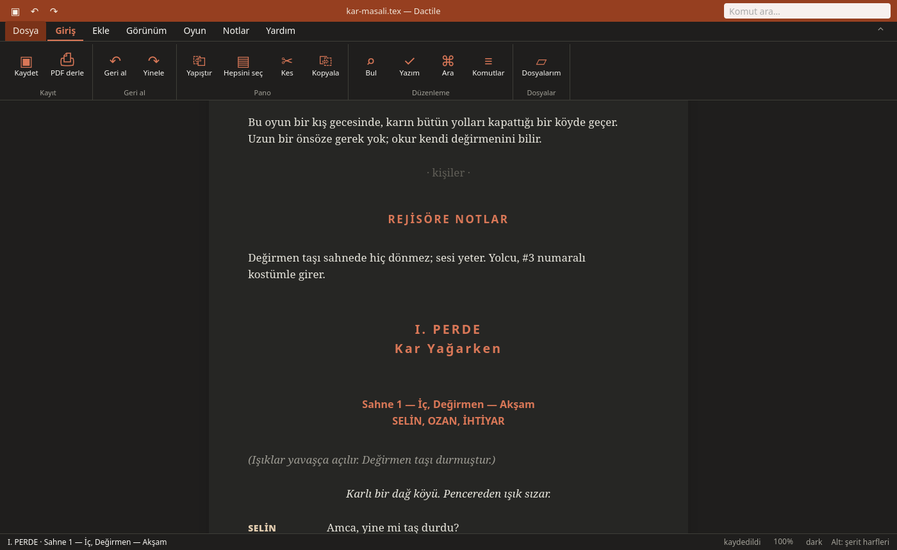
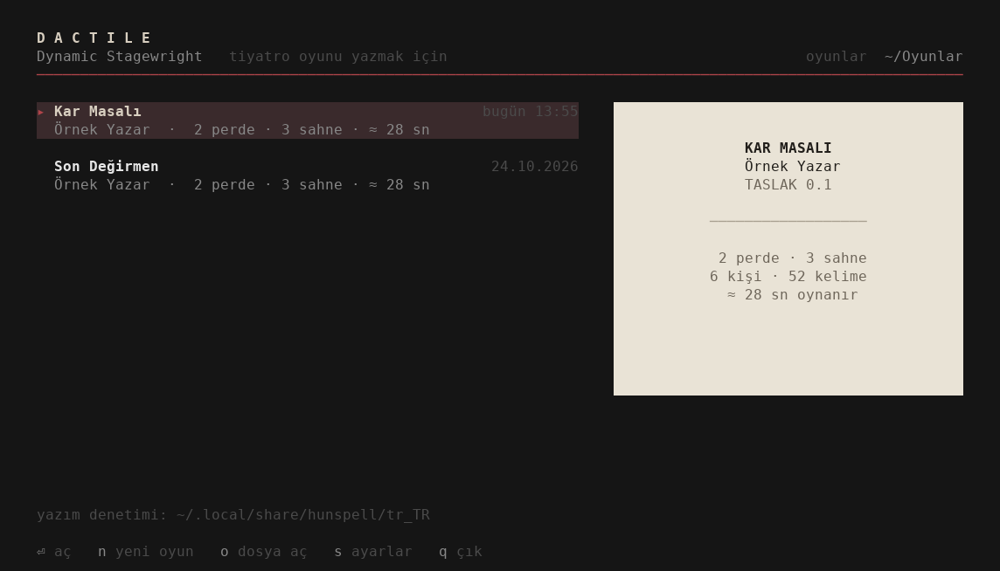
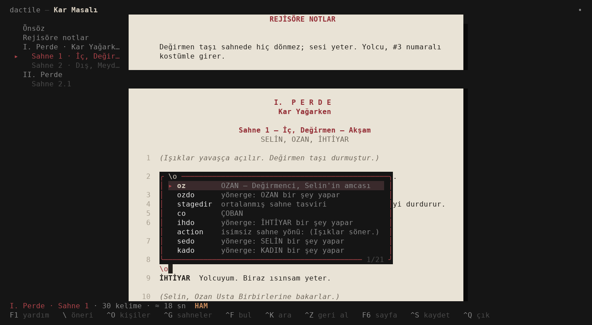
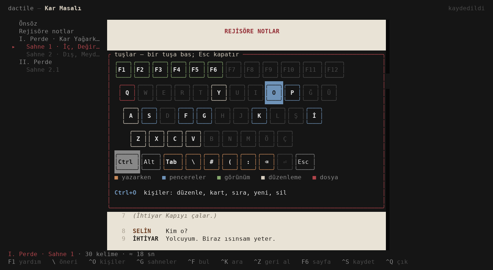
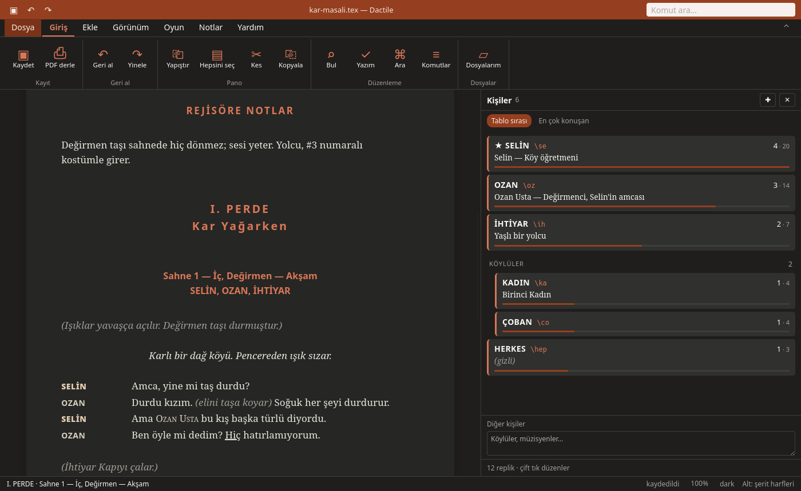

# Dactile — Dynamic Stagewright

[English](README.md)

Tiyatro oyunu yazmak için bir masaüstü uygulaması; terminal sürümünün adı
Dactile Light. Oyunu **tiyatro** XeLaTeX sınıfının sözdizimiyle yazarsın; makrolar yazarken canlanır: `\se Amca`
anında `SELİN   Amca` olur, `\sahne` yer ve zaman sorup numaralı bir sahne
açar, sahnede görünen karakterler kendiliğinden sahne başlığının altında
toplanır.

Dosya düz bir `.tex` olarak kalır ve XeLaTeX ile derlenir. Dactile'da yazılan
bir oyun her TeX düzenleyicisinde açılır, başka yerde yazılmış oyunlar da
Dactile'da açılır.



> Beta. Her değişiklik metnin kendisinde bir düzenlemedir, atomik kaydedilir
> ve eski sürümler saklanır; ama uygulama yeni, değerli metinlerinin bir
> kopyasını tut.

```latex
\karakter*[Selin][Köy öğretmeni]{SELİN}{se}
\karakter[Ozan Usta][Değirmenci]{OZAN}{oz}

#perde Kar Yağarken
#sahne İç, Değirmen — Akşam

\se Amca, yine mi taş durdu?
\oz Durdu kızım. \ic{elini taşa koyar} Soğuk her şeyi durdurur.
\sedo\ozdo Birbirlerine bakarlar.
```

Tüm özellikler için: [examples/ornek-oyun.tex](examples/ornek-oyun.tex).

## Kurulum

Linux'ta, [Releases](https://github.com/D4shwood/dactile/releases) sayfasından:

```sh
chmod +x Dactile-*-x86_64.AppImage
./Dactile-*-x86_64.AppImage
```

Arch'ta AUR'daki `dactile-bin`, `dactile` komutunu, bir menü girdisini ve
Dactile Light'ı kurar.

Kaynaktan kurmak WebKitGTK ve Node.js ister: `app/` içinde `npm install`,
ardından `npm run tauri dev`.

**Dactile Light**, aynı yazıcının terminal sürümüdür:

```sh
tar xzf dactile-light-*-x86_64-linux.tar.gz
cd dactile-light-*-x86_64-linux
./dactile-light install
```

`dactile-light install`, `dactile-light` komutunu `~/.local/bin`'e koyar,
menüye bir girdi ekler ve tiyatro sınıfını TeX ağacına (`~/texmf`) kopyalar;
böylece oyunlar her klasörden derlenir. `dactile-light uninstall` üçünü de
kaldırır; oyunların ve ayarların kalır. Kaynaktan:
`cargo install --path tui`, ardından `dactile-light install`.

0.3'ten önce terminal uygulaması `dactile` komutuydu: `dactile uninstall`
onu kaldırır.

- **Yazım denetimi** için Türkçe bir Hunspell sözlüğü (`tr_TR.aff` ve
  `tr_TR.dic`) `~/.local/share/hunspell` ya da `/usr/share/hunspell` içinde
  olmalı; Arch'ta `paru -S hunspell-tr`. Sözlük yoksa geri kalan her şey
  çalışır.
- **PDF** için XeLaTeX gerekir (`texlive-xetex` ve `texlive-latexextra` ya da
  tam bir TeX Live).

## Kullanım

Bu sayfa Dactile Light'ın tuşlarını ve ekranlarını anlatır; masaüstü uygulaması
aynı oyunları ve araçları bir sayfa üstünde, şerit ve fareyle sunar.

```sh
dactile-light                   # ana ekran: oyunların, yeni oyun, ayarlar
dactile-light oyun.tex          # doğrudan bir oyuna
dactile-light new "Kar Masalı"  # oyunlar klasöründe yeni bir oyun
dactile-light import oyun.docx  # bir belgeden oyun (bkz. İçe aktarma)
```

İlk açılışta dil (Türkçe ya da İngilizce), oyunların duracağı klasör, adın ve
öneri menüsünün nasıl açılacağı sorulur.



Ana ekran bir kelime işlemcinin açılış ekranı gibi dizilir. Soldaki sütun
Giriş, Yeni, Aç, Ayarlar ve Tuşlar bölümlerine götürür; Tab sütun, kutucuklar
ve liste arasında gezer, fare de çalışır. Oyunların üstündeki kutucuklar yeni
bir oyun başlatır: boş bir oyun, tek ya da üç perdelik bir iskelet, bir dosya
açmak ya da içe aktarmak, ya da örnek oyunun bir kopyası. Yeni (`n`) bütün
şablonları gösterir: bu dördü, bir monolog, kısa bir skeç ve seninkiler.
Yazıcıda Dosya › Şablon olarak kaydet, bir oyunun kapağını, kişilerini,
perdelerini ve sahnelerini repliksiz olarak `~/.config/dactile/templates`
klasörüne yazar; Yeni'de `d` seninkilerden birini çöp kutusuna atar.

Ana ekranda `d` seçili oyunun yeni bir adla kopyasını çıkarır; `f` yanına
yeni bir taslağını açar (`kar-masali-0.2.tex`: taslak numarası bir artar,
karakter kartları da gelir). Taslaklar geldikleri oyunun üstünde ağaç gibi
birikir, en yenisi en üstte; ana ekran en son çalıştığın oyunda açılır. F2
dosya yöneticisindeki gibi oyunun adını kendi satırında değiştirir: yeni başlığı
yazarsın, dosya adı ve yanındaki dosyalar da onu izler (taslak, dosya adının
sonundaki numarasını korur). Shift+F2 başlığı ve dosya adını ayrı ayrı sorar; `p`
PDF'ini açar; iki kez Del onu masaüstünün çöp kutusuna atar, `u` geri getirir;
`?` bütün tuşları gösterir. Listenin yanında seçili oyunun ilk sayfası durur:
ekran boyunca, yazıcıdaki gibi dizilmiş, yazıcının temasında. Listenin altında,
sayfanın diplerine hizalı: oyunun sahnelerinden bir şerit (her sahne
oynandığı kadar uzun), sahneler ve süreleri, kim ne kadar konuşuyor.

| Yazınca | Olan |
|---|---|
| `\se ` (kısaltma ve boşluk) | SELİN'in repliği; tanımlanmamış bir kısaltma yeni karakter formunu açar |
| `\sedo ` | bir yönerge, `(Selin …)`; oyunda en çok kullanılan fiiller önerilir |
| `\` | öneri menüsü: karakterler (sahnedekiler önce), komutlar, makrolar |
| satır başında `#` | başlıklar: `#sahne`, `#önsahne`, `#perde`, `#önsöz`, `#notlar` (rejisöre notlar) |
| `#sahne İç, Değirmen — Akşam` | doğrudan yazılmış bir sahne; `#` menüsünden seçilirse yer ve zaman sorulur |
| satır başında `SELİN:` | SELİN'in repliği (adlarından biri, büyük küçük fark etmez); büyük harfle yazılmış bilinmeyen bir ad yeni karakter formunu açar |
| boş satırda Tab | sıradaki konuşan, soluk gösterilir: son konuşandan öncekisi |
| `((` | replik içinde yönerge, `\ic{…}` |
| satır başında ^V | başka yerden yapıştırılan taslak: `AD: …` satırları replik, `(…)` satırları yönerge, `#…` satırları başlık olur |

Makrolar chip olarak görünür; imleç üstünden atlar. İçine Backspace ile
girince, sen çıkana kadar satırın kaynağı görünür. F2 bütün oyunu kaynak
olarak gösterir.

Sayfa PDF gibi okunur, perde sonunda "Perde Sonu" yazar. F7 metni A4
yapraklara böler: PDF'in yeni sayfa açtığı yerlerde (kapak, önsöz, kişiler,
her perde) ve yaprak dolunca; altta sayfa numarasıyla. Geniş ekranda oyunun iskeleti kenarda
durur; tıklayınca oraya gider.



| Tuş | |
|---|---|
| F10 | üstteki şerit, bir kelime işlemcideki gibi: sekmeler (Dosya, Giriş, Ekle, Görünüm, Oyun, Notlar, Yardım) ve altında gruplanmış düğmeler; F10 her sekmenin, sonra her düğmenin üstünde bir harf gösterir (F10 E A bir sahne yönergesi ekler), oklar ve fare de çalışır. Dosya ayrı bir sayfa açar: oyunun bilgileri, PDF, kopyalar, şablonlar. ^F1 şeridi sekmelerine katlar |
| ^P | komut paleti: her şey adıyla — yeni sahne, temalar, sayfa görünümü, animasyonlar… |
| ^O | kişiler: düzenle, kısaltmayı her yerde değiştir, sıra, karakter kartları; m birini ötekiyle birleştirir, b birini böler (seçtiğin sahneler yeni karaktere geçer); g yeni grup (üyeleriyle birlikte), t karakteri bir gruba ya da gruptan dışarı taşır, grupta n yeni üye, e grubun adı, d grubu dağıtır |
| ^N, Alt+N | yazının yanında notlar (aşağıda); seçili söze ya da imleçteki kelimeye not |
| ^G, ^G ^G | yazının yanında sahne şeridi; hızlıca iki kez: pano (aşağıda) |
| F9 | dağıtım: kim kimi oynuyor, sahne/rol tablosu, sayılar (aşağıda) |
| Alt+E, Alt+B, Alt+J | imlecin sahnesinin özeti; sahneyi imlecin satırından böl; sonrakiyle birleştir |
| ^K | karakter ve komut ara |
| ^F | bul ve değiştir |
| Alt+I | oyun bilgisi (başlık, yazar, taslak no…) ve taslak/final |
| Alt+S | imleçteki kelime için yazım önerileri |
| Alt+P | kaynaktaki kişi ve oyun bilgisi satırlarını aç |
| F5, Alt+O, Alt+L | PDF'i oyunun yanına derle (arka planda, tek XeLaTeX geçişi); görüntüleyicide aç. XeLaTeX'i durduracak yerlerin altı yazarken soluk çizilir (imleç üstündeyken ne olduğu yazar); `&`, `$`, `^`, yersiz `_` ve `%50` kayıtta sessizce kaçırılır; kapanmamış bir `{` ya da tanımsız bir komut F5'i orada durdurur, F5 bir daha yine de derler; XeLaTeX yine de düşerse Alt+L logunu açar |
| F3 / F4 / F8 | daktilo, sahne odağı, gerisini soldur |
| Shift+F8 | rol görünümü: imleçteki rolün replikleri parlak, kalanı soluk |
| F6 | tema: kâğıt, sepya, gece, yüksek kontrast, koyu |
| F7 | sayfa görünümü: PDF'in böldüğü yerlerden bölünmüş, numaralı A4 yapraklar |
| ^Z ^Y, ^C ^X ^V | geri al, yinele, kopyala, kes, yapıştır |
| ^S, ^Q | kaydet (zaten kendiliğinden kaydeder), çık |
| F1 | bir klavye: bir tuşa bas, ne yaptığını görürsün |





### Pano

^G yazının yanında bir şerit açar: perdeler ve sahneler, imlecin sahnesi
vurgulu ve açık; özeti, süresi, içindekiler. Ekran sayfaya ve şeride darsa
kenara çekilir. ^G'ye hızlıca iki kez basınca pano tam ekran açılır: liste ya
da (Tab) kartlar; perdeler sütun, sahneler yer, süre, kişiler ve özetle kart.

- ⏎ sahneye gider; `e` özetini yazar (bir iki cümle, PDF'e girmez; yazıcıda
  da başlığın altında soluk durur, orada Alt+E).
- Alt+↑↓ sahneyi bir yer kaydırır, perde sınırını geçince öbür perdeye düşer;
  kartlarda Alt+←→ önceki ya da sonraki perdeye. `m` ile tutarsın, oklarla
  yer seçersin, ⏎ bırakır. Perdeler bütün taşınır, işaretliler (␣) birlikte.
  Her taşıma tek geri alma adımı.
- `j` sahneyi sonrakiyle birleştirir: ikinci başlık yeriyle bir yönerge olur.
  Yazıcıda Alt+B sahneyi imlecin satırından böler.
- `n` yeni kart açar: gizli bir sahne (`%~`), ⏎ ile içine yazmak için açana
  kadar PDF'te yok.
- `h` gizler (`%~` satırları), `t` oyunun çöp kutusuna atar, `c` çöp kutusunu
  gösterir: r geri koyar, x x yok eder.

Bir oturumdaki ilk taşıma, bölme ya da birleştirmeden önce oyunun o anki hâli
yanına taslak olarak saklanır (`oyun-0.2.tex`); sen oyunun kendisinde devam
edersin. Özeti olan bir sahnenin başlığının sonunda PDF'in görmediği kısa bir
kimlik durur, `#sahne Meydan %@k3`: özet sahne nereye giderse peşinden gider.

### Dağıtım

F9 kimin kimi oynadığını tam ekran açar; üç görünüm var (Tab):

- **dağıtım**: roller, her birinin oyuncusu (⏎ ile yazılır), repliği,
  kelimesi, süresi ve sahneleri. Bir oyunun birden çok dağıtımı olabilir, A ve
  B kadrosu gibi: ←→ aralarında gezer, `n` yenisini açar (şimdikinin
  kopyası), `r` adını değiştirir, `x` siler. `k` her oyuncuya, oyuncusu
  henüz yazılmamış her role de (`ROL.pdf`) bir kopya çıkarır: 1 tam, 2 prova,
  3 hafif prova; `z` rolü ezberletir.
- **tablo**: sahneler satırda, roller sütunda; ● rol konuşuyor, ○ sahnede ama
  konuşmuyor. ⏎ sahneye gider, `x` CSV (`oyun-tablo.csv`), `p` yatay bir PDF
  (`oyun-tablo.pdf`) yazar.
- **sayılar**: rol başına replik, kelime, süre ve pay; sahne ve perde
  uzunlukları. `w` oyunun konuşma hızını (dakikada kelime) ayarlar.

Oyuncu kopyasında (`oyun-kopyalar/Oyuncu (ROL).pdf`) oyuncunun replikleri
kalın, gerisi tam ama soluk; giriş ve çıkışları kalın; olmadığı sahnelerden
yalnız başlık kalır. Kapakta adı, sahneleri ve sayfaları, ne kadar konuştuğu
yazar. Prova kopyasında (`… - prova.pdf`) kimin ne sırayla konuştuğu durur
ama ötekilerin sözleri yerine not alacak boşluk kalır; oyuncu onları okumadan
prova eder. Hafif provada her replikten ilk bir-üç kelime kalır (her
çıkarışta aynı). `o` son tabloyu ya da kopyaları açar.
Oyuncu adları sidecar'da kalır; oyunun kendi PDF'i onları hiç göstermez.

Ezber (F9'da `z`, ya da ^P'de "Ezber" ile imleçteki rol) rolün her
repliğinden önceki satırları gösterir, repliği gizler: Boşluk kelimelerin ilk
harflerini, bir daha hepsini gösterir, sonra sıradakine geçer.

Dactile bir oyunun yanında `oyun.dactile.toml` tutar: karakter kartları, sahne
özetleri, dağıtımlar ve yazım denetimi için oyunun kendi kelimeleri (PDF'e hiç
girmez). Oyun açıkken
bir de `.oyun.tex.dactile-lock` durur; ikinci bir Dactile oyunu salt okunur
açar. Eski sürümler `~/.local/share/dactile/history` içine gider.

### İçe aktarma

Ana ekranda `i`, başka yerde yazılmış bir oyun için masaüstünün dosya
seçicisini açar (olmayan yerde, SSH'te mesela, yol sorar): Word `.docx`,
LibreOffice `.odt`, içinde metin olan bir PDF, Markdown ya da düz metin.
Başka bir şey kurmak gerekmez; `pdftotext` kuruluysa PDF daha temiz okunur
ve Dactile onu kullanır.

Dactile başlığı ve yazarı, açıklamalarıyla bir kişiler listesini (`KİŞİLER`,
`CHARACTERS`), perde ve sahne başlıklarını (`BİRİNCİ PERDE`, `2. Sahne: Ahır`,
`ACT ONE`), önsözü ve notları, `AD: …`, `AD — …`, `AD. …` diye ya da ad kendi
satırında, üstlerinde yazılmış replikleri bulur. Parantez içindeki ya da
baştan sona italik bir paragraf yönergedir; bir replik içinde `(gülerek)` ya
da italik kelimeler satır içi yönerge olur. PDF'te sayfa başlıkları, sayfa ve
kenar satır numaraları atılır, sayfa genişliğinden kırılmış satırlar
birleştirilir; kısa satırlar şiirdeki gibi kalır.

Oyun yazılmadan önce bir önizleme bulunan adları, kaçar replikleri ve ilk
replikleriyle listeler: `e` adı, `a` kısaltmayı değiştirir, `m` aynı kişi
olan iki adı birleştirir (ve yeniden ayırır), `x` hiç karakter olmayanı
(`NOT: …`) işaretler, onun satırları metin olarak kalır; `t` başlık ve yazar.
⏎ oyunu oyunlar klasörüne yazar ve açar. `dactile-light import DOSYA` aynısını
komut satırından, adları geldiği gibi alarak yapar. Taranmış bir PDF, sayfa
resimleri, önce OCR'dan geçmeli.

Kitaptan gelen bir oyunun çevresinde yayınevinin eklediği sayfalar olur: kapak,
künye, içindekiler, önsöz, yazar tanıtımı. Oyun, kişilerin birbirine cevap
verdiği yerden bulunur ve yalnızca o bölüm konuşmacı için okunur; masaüstü
uygulamasının önizlemesi öteki sayfaları listeler, işaretlenen düz metin olarak
oyuna girer. Önsöz ve notlar oyunun kendi bölümleri olarak kalır.

### Notlar

Oyun üstüne herkesin notu (bir AI'ın okuması, atölye, bir okur, kendin)
oyunun yanında, `oyun.notlar.md` içinde durur: her editörün (Obsidian'ın da)
okuyup yazabildiği bir Markdown görev listesi:

```text
## Düz yazım yanlışları

- [ ] 139 · **Claude** · “Gaztesi” → Gazetesi
  - **Deniz**: ikinci perdede de aynı
- [x] 20 · **Atölye** · “loş bir bir ışığın”: çift “bir”
```

`[ ]` açık, `[x]` çözüldü, `[-]` gizli; `## Arşiv: …` altındakiler arşivde.
Sayı oyunun bir satırıdır; not yerini alıntıladığı sözle yeniden bulur, üstüne
satır eklense de kaybolmaz, kaydedince sayısı da onu izler.

^N notları sağda açar: ↑↓ birinden ötekine gider, metin onun yerine kayar ve
yer yanar; Esc panel açık kalarak metne döner, ^N yine kapatır. Açık notlar
metinde yazarlarının renginde altı çizili, kenarda bir noktayla görünür.
Panelde:

| Tuş | |
|---|---|
| p | bir cevabı yapıştır (bir AI'ınki, bir okurun e-postası): numaralı her madde (`139: …`, `- 20: …`, `• 68 (gazete metni): …`) bir not, bir dizi maddenin üstündeki kısa satır başlıkları olur; kimden geldiğini sorar |
| i | bir not dosyasını (`.md`, `.txt`) aynı yolla al (ya da Dactile'ın kendi biçimindekini) |
| n | seçili söze ya da imleçteki kelimeye kendi notun (metinden Alt+N) |
| ␣ | çözüldü, üstü çizili; ya da yeniden açık |
| u | notun düzeltmesini yap, `“yanlış” → doğru`: yalnız farklı sözler değişir, ^Z geri alır, not çözülür |
| r, e | cevap yaz; notu, satırını ve cevaplarını düzenle |
| h, a, x | gizle, arşivle, sil (x iki kez) |
| f, s | yalnız bir yazarın notları; çözülen, gizli ve arşivdekiler de |
| c, o | açık notlar kenarda, numaralı, her biri yazarının renginde bir PDF kopya; sonda hepsi cevaplarıyla (`oyun - notlu.pdf`); onu aç |

Notun alıntıladığı söz metinden gidince panel "düzeltilmiş gibi" der; çizmek
sana kalır. Oyun kendiliğinden hiç değişmez.

## tiyatro sınıfı

Sınıf [tex/](tex/) klasöründe; Dactile onu kendi içinde taşır.

- **Karakterler** kısaltmalarla tanımlanır:
  - `\karakter`
  - gruplar (`\karaktergrubu`)
  - kişiler tablosuna girmeyenler (`\gizlikarakter`)
  - replik içinde geçen ad (`\setinlinename`)
- **Replik** altındaki satırlara da sürer; her kaynak satır baskıda kendi
  satırında durur. Boş bir satır ya da komutla veya `#` ile başlayan bir
  satır repliği bitirir. Ad kendi sütununda durur; satır sonundaki `%`
  sonraki satırı ona ekler.
- **Yönergeler:** `\aliasdo` zincirleri, `\action`, `\stagedir`, `\middir`, `\ic`, `\beat`;
  giriş-çıkışlar, `\girer{se,oz}` → (SELİN ile OZAN girerler.), `\cikar{se}`.
- **Perdeler ve sahneler** otomatik numaralanır. Sahne başlığında o sahnede kimlerin olduğu yazar; bunun için iki derleme gerekir.
- **Başlıklar `#` satırı olarak:** `#perde Başlık`, `#sahne Yer — Zaman`,
  `#sahne[2.1] Yer`, `#önsöz`, `#notlar` (`#act`, `#scene`, `#preface`,
  `#notes` de olur). `\#` bir `#` basar; `\perde[…]` ve `\sahne[…]` eskisi
  gibi çalışır.
- **Ön sahne:** `#önsahne Yer` (ya da `\onsahne[Yer]`) numarasız bir
  "Ön Sahne" başlığı basar; ardından gelen `#sahne` yine Sahne 1 olur.
- **Önsöz** (`\onsoz`) ve **rejisöre notlar** (`\notlar`), her biri kendi
  sayfasında.
- **Kişiler tablosu** (`\kisiler`) ve kapak.
- **Taslak ve final modları:**

  | Mod | Font | Satır aralığı | Kenar | Kapak |
  |---|---|---|---|---|
  | taslak | sans | 1,5 | her repliğe ve yönergeye bir numara | "TASLAK" |
  | final | serif | tek | yok | yıldızlı karakterler |

- **Seçenekler:** `nohash` `#`'i yeniden sıradan bir karakter yapar; `nonotes`
  rejisöre notları o kopyadan çıkarır. Bir `#` satırı kaynak satırın sonunda
  ya da üstündeki bir `%` yorumunda biter.
- **Oyuncu kopyaları**, Dactile'ın oyunun bir kopyasının önsözüne yazdığı
  komutlarla: `\tiyatrocopy{se}{Oyuncu}` o rolün repliklerini kalın yapar ve
  gerisini soldurur (`xcolor` paketi); bir yönergeden önce `\tiyatromark` onu
  kalın yapar; `\tiyatrocopycover{…}` kapağa ekler; `\tiyatrogap{n}` bir
  repliğin sözleri yerine n satırlık boşluk bırakır.
- **Notlu kopya:** önsözde `\tiyatronotes` sağ kenarı genişletir,
  `\tiyatronote{RRGGBB}{Kim}{n}{metin}` n. notu satırının yanına koyar,
  `\tiyatronoted{RRGGBB}{söz}` notun söylediği sözü boyar,
  `\tiyatronoteslist{Başlık}{…}` oyunun sonundan sonra hepsini
  `\tiyatronoteitem` ve `\tiyatronotereply` ile listeler.

```sh
xelatex oyun.tex
```

Sınıf, her sahnede kimin olduğunu (başlığın altındaki liste) ancak sahne bitince
öğrenir; bu yüzden listeleri bir sonraki geçiş için `.aux` dosyasında tutar.
Dactile onları her F5'ten önce, `.aux` varken her kayıtta da oraya yazar;
böylece tek geçiş yeter. Başka bir
yerde düzenlendiyse sınıf "Rerun to get them right" der; ikinci geçiş düzeltir.

Sınıf [tiyatro-latex](https://github.com/D4shwood/tiyatro-latex)'ten doğdu ve
Dactile için yeniden yazıldı. Karakterleri komut olarak tanımlama fikri Davide
Fauri'nin [theatre.cls](https://github.com/DavideFauri/theatre) sınıfından
geliyor; onun kodu burada kullanılmıyor.

## Yol haritası

Bir hata turu ve AUR paketiyle 1.0, sonra rol ikilemesi ve süreklilik
denetimi: bkz. [TODO.md](TODO.md).

## Lisans

Uygulama da sınıf da GPL-3.0-or-later. Bkz. [LICENSE](LICENSE).
