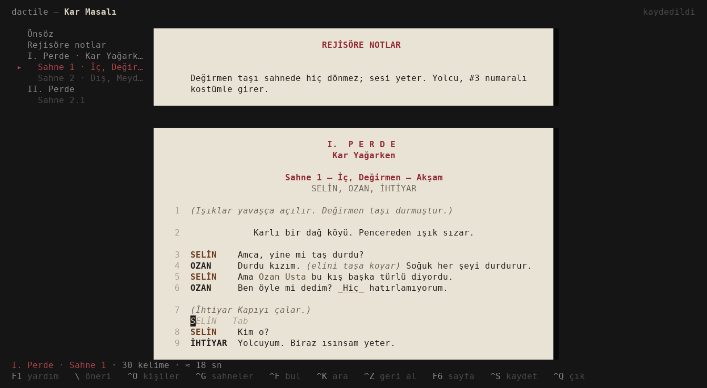
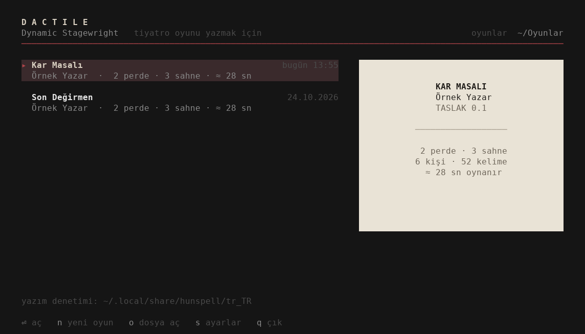
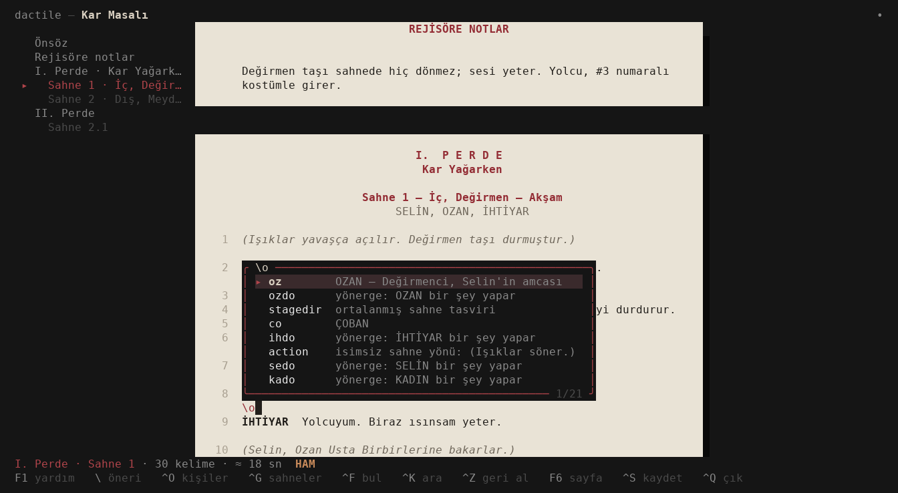
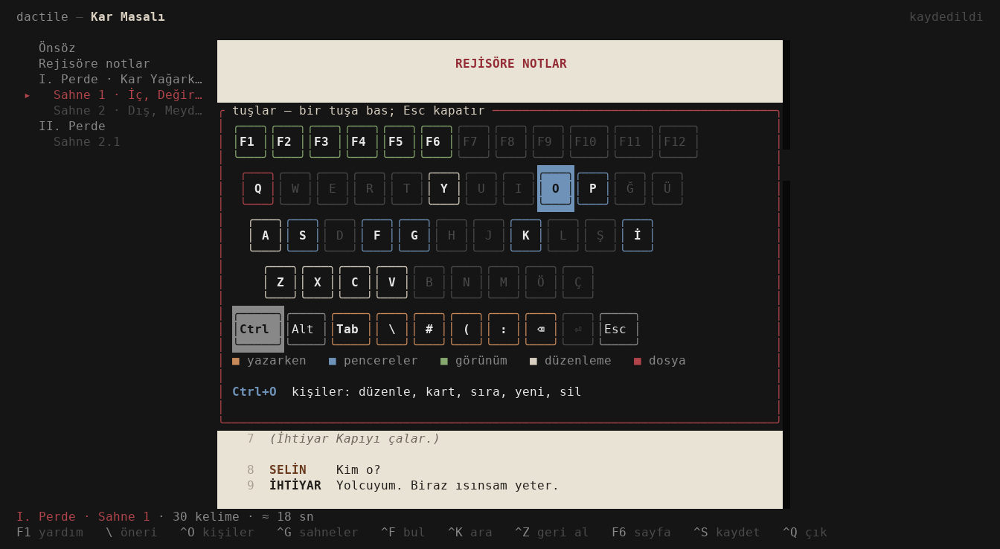
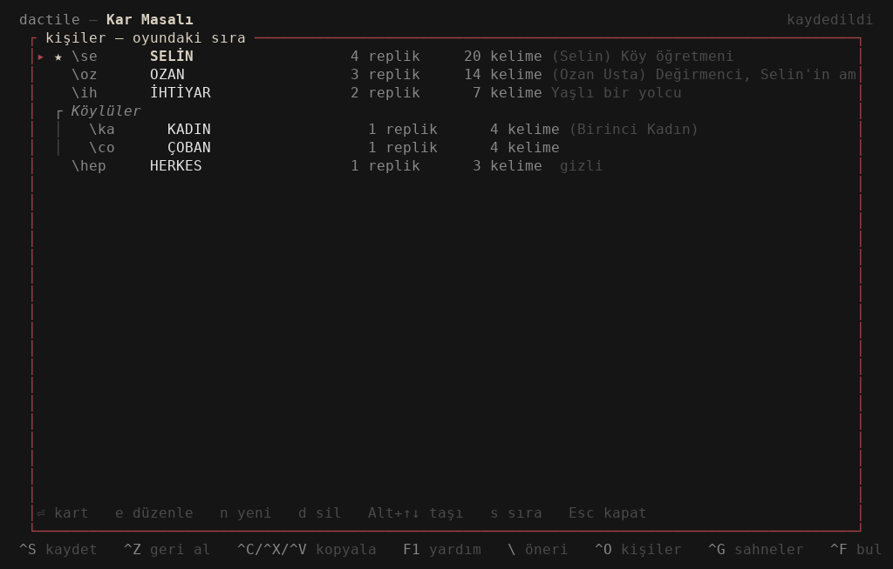

# Dactile — Dynamic Stagewright

[English](README.md)

Tiyatro oyunu yazmak için bir terminal uygulaması. Oyunu **tiyatro** XeLaTeX
sınıfının sözdizimiyle yazarsın; makrolar yazarken canlanır: `\se Amca`
anında `SELİN   Amca` olur, `\sahne` yer ve zaman sorup numaralı bir sahne
açar, sahnede görünen karakterler kendiliğinden sahne başlığının altında
toplanır.

Dosya düz bir `.tex` olarak kalır ve XeLaTeX ile derlenir. Dactile'da yazılan
bir oyun her TeX düzenleyicisinde açılır, başka yerde yazılmış oyunlar da
Dactile'da açılır.



> Beta. Her değişiklik metnin kendisinde bir düzenlemedir, atomik kaydedilir
> ve eski sürümler saklanır; ama uygulama yeni, değerli metinlerinin bir
> kopyasını tut.

```latex
\karakter*[Selin][Köy öğretmeni]{SELİN}{se}
\karakter[Ozan Usta][Değirmenci]{OZAN}{oz}

#perde Kar Yağarken
#sahne İç, Değirmen — Akşam

\se Amca, yine mi taş durdu?
\oz Durdu kızım. \ic{elini taşa koyar} Soğuk her şeyi durdurur.
\sedo\ozdo Birbirlerine bakarlar.
```

Tüm özellikler için: [examples/ornek-oyun.tex](examples/ornek-oyun.tex).

## Kurulum

Linux'ta [Releases](https://github.com/D4shwood/dactile/releases) sayfasından:

```sh
tar xzf dactile-*-x86_64-linux.tar.gz
cd dactile-*-x86_64-linux
./dactile install
```

`dactile install` `dactile` komutunu `~/.local/bin`'e koyar, menüye bir girdi
ekler ve tiyatro sınıfını TeX ağacına (`~/texmf`) kopyalar; oyunlar her
klasörden derlenir. `dactile uninstall` üçünü de kaldırır; oyunların ve
ayarların kalır.

Kaynaktan: `cargo install --path .`, ardından `dactile install`.

- **Yazım denetimi** için Türkçe bir Hunspell sözlüğü (`tr_TR.aff` ve
  `tr_TR.dic`) `~/.local/share/hunspell` ya da `/usr/share/hunspell` içinde
  olmalı; Arch'ta `paru -S hunspell-tr`. Sözlük yoksa geri kalan her şey
  çalışır.
- **PDF** için XeLaTeX gerekir (`texlive-xetex` ve `texlive-latexextra` ya da
  tam bir TeX Live).

## Kullanım

```sh
dactile                   # ana ekran: oyunların, yeni oyun, ayarlar
dactile oyun.tex          # doğrudan bir oyuna
dactile new "Kar Masalı"  # oyunlar klasöründe yeni bir oyun
```

İlk açılışta dil (Türkçe ya da İngilizce), oyunların duracağı klasör, adın ve
öneri menüsünün nasıl açılacağı sorulur.



Ana ekranda `d` seçili oyunun yeni bir adla kopyasını çıkarır; `f` yanına
yeni bir taslağını açar (`kar-masali-0.2.tex`: taslak numarası bir artar,
karakter kartları da gelir). Taslaklar geldikleri oyunun üstünde ağaç gibi
birikir, en yenisi en üstte; ana ekran en son çalıştığın oyunda açılır. F2
dosya yöneticisindeki gibi oyunun adını kendi satırında değiştirir: yeni başlığı
yazarsın, dosya adı ve yanındaki dosyalar da onu izler (taslak, dosya adının
sonundaki numarasını korur). Shift+F2 başlığı ve dosya adını ayrı ayrı sorar; `p`
PDF'ini açar; iki kez Del onu masaüstünün çöp kutusuna atar, `u` geri getirir.

| Yazınca | Olan |
|---|---|
| `\se ` (kısaltma ve boşluk) | SELİN'in repliği; tanımlanmamış bir kısaltma yeni karakter formunu açar |
| `\sedo ` | bir yönerge, `(Selin …)`; oyunda en çok kullanılan fiiller önerilir |
| `\` | öneri menüsü: karakterler (sahnedekiler önce), komutlar, makrolar |
| satır başında `#` | başlıklar: `#sahne`, `#perde`, `#önsöz`, `#notlar` (rejisöre notlar) |
| `#sahne İç, Değirmen — Akşam` | doğrudan yazılmış bir sahne; `#` menüsünden seçilirse yer ve zaman sorulur |
| satır başında `SELİN:` | SELİN'in repliği (adlarından biri, büyük küçük fark etmez); büyük harfle yazılmış bilinmeyen bir ad yeni karakter formunu açar |
| boş satırda Tab | sıradaki konuşan, soluk gösterilir: son konuşandan öncekisi |
| `((` | replik içinde yönerge, `\ic{…}` |
| satır başında ^V | başka yerden yapıştırılan taslak: `AD: …` satırları replik, `(…)` satırları yönerge, `#…` satırları başlık olur |

Makrolar chip olarak görünür; imleç üstünden atlar. İçine Backspace ile
girince, sen çıkana kadar satırın kaynağı görünür. F2 bütün oyunu kaynak
olarak gösterir.

Sayfa PDF gibi okunur, perde sonunda "Perde Sonu" yazar. F7 metni A4
yapraklara böler: PDF'in yeni sayfa açtığı yerlerde (kapak, önsöz, kişiler,
her perde) ve yaprak dolunca; altta sayfa numarasıyla. Geniş ekranda oyunun iskeleti kenarda
durur; tıklayınca oraya gider.



| Tuş | |
|---|---|
| ^P | komut paleti: her şey adıyla — yeni sahne, temalar, sayfa görünümü, animasyonlar… |
| ^O | kişiler: düzenle, kısaltmayı her yerde değiştir, sıra, karakter kartları; m birini ötekiyle birleştirir, b birini böler (seçtiğin sahneler yeni karaktere geçer) |
| ^G | perdeler ve sahneler: oraya git; ␣ işaretler, h gizler (`%~` satırları, PDF'te yok), t oyunun çöp kutusuna atar; Tab çöp kutusu: r geri koyar, x x yok eder |
| ^K | karakter ve komut ara |
| ^F | bul ve değiştir |
| Alt+I | oyun bilgisi (başlık, yazar, taslak no…) ve taslak/final |
| Alt+S | imleçteki kelime için yazım önerileri |
| Alt+P | kaynaktaki kişi ve oyun bilgisi satırlarını aç |
| F5, Alt+O | PDF'i oyunun yanına derle (arka planda, tek XeLaTeX geçişi); görüntüleyicide aç. XeLaTeX'i durduracak yerlerin altı yazarken soluk çizilir (imleç üstündeyken ne olduğu yazar); `&`, `$`, `^`, yersiz `_` ve `%50` kayıtta sessizce kaçırılır; kapanmamış bir `{` ya da tanımsız bir komut F5'i orada durdurur, F5 bir daha yine de derler |
| F3 / F4 / F8 | daktilo, sahne odağı, gerisini soldur |
| F6 | tema: kâğıt, sepya, gece, yüksek kontrast, koyu |
| F7 | sayfa görünümü: PDF'in böldüğü yerlerden bölünmüş, numaralı A4 yapraklar |
| ^Z ^Y, ^C ^X ^V | geri al, yinele, kopyala, kes, yapıştır |
| ^S, ^Q | kaydet (zaten kendiliğinden kaydeder), çık |
| F1 | bir klavye: bir tuşa bas, ne yaptığını görürsün |





Dactile bir oyunun yanında `oyun.dactile.toml` tutar: karakter kartları ve
yazım denetimi için oyunun kendi kelimeleri (PDF'e hiç girmez). Oyun açıkken
bir de `.oyun.tex.dactile-lock` durur; ikinci bir Dactile oyunu salt okunur
açar. Eski sürümler `~/.local/share/dactile/history` içine gider.

## tiyatro sınıfı

Sınıf [tex/](tex/) klasöründe; Dactile onu kendi içinde taşır.

- **Karakterler** kısaltmalarla tanımlanır:
  - `\karakter`
  - gruplar (`\karaktergrubu`)
  - kişiler tablosuna girmeyenler (`\gizlikarakter`)
  - replik içinde geçen ad (`\setinlinename`)
- **Replik** kaynak satırın sonuna kadar sürer; ad kendi sütununda durur.
- **Yönergeler:** `\aliasdo` zincirleri, `\action`, `\stagedir`, `\middir`, `\ic`, `\beat`.
- **Perdeler ve sahneler** otomatik numaralanır. Sahne başlığında o sahnede kimlerin olduğu yazar; bunun için iki derleme gerekir.
- **Başlıklar `#` satırı olarak:** `#perde Başlık`, `#sahne Yer — Zaman`,
  `#sahne[2.1] Yer`, `#önsöz`, `#notlar` (`#act`, `#scene`, `#preface`,
  `#notes` de olur). `\#` bir `#` basar; `\perde[…]` ve `\sahne[…]` eskisi
  gibi çalışır.
- **Önsöz** (`\onsoz`) ve **rejisöre notlar** (`\notlar`), her biri kendi
  sayfasında.
- **Kişiler tablosu** (`\kisiler`) ve kapak.
- **Taslak ve final modları:**

  | Mod | Font | Satır aralığı | Kenar | Kapak |
  |---|---|---|---|---|
  | taslak | sans | 1,5 | her repliğe ve yönergeye bir numara | "TASLAK" |
  | final | serif | tek | yok | yıldızlı karakterler |

- **Seçenekler:** `nohash` `#`'i yeniden sıradan bir karakter yapar; `nonotes`
  rejisöre notları o kopyadan çıkarır. Bir `#` satırı, replik gibi, kaynak
  satırın sonunda biter; oradaki bir `%` sonraki satırı ona ekler.

```sh
xelatex oyun.tex
```

Sınıf, her sahnede kimin olduğunu (başlığın altındaki liste) ancak sahne bitince
öğrenir; bu yüzden listeleri bir sonraki geçiş için `.aux` dosyasında tutar.
Dactile onları her F5'ten önce, `.aux` varken her kayıtta da oraya yazar;
böylece tek geçiş yeter. Başka bir
yerde düzenlendiyse sınıf "Rerun to get them right" der; ikinci geçiş düzeltir.

Sınıf [tiyatro-latex](https://github.com/D4shwood/tiyatro-latex)'ten doğdu ve
Dactile için yeniden yazıldı. Karakterleri komut olarak tanımlama fikri Davide
Fauri'nin [theatre.cls](https://github.com/DavideFauri/theatre) sınıfından
geliyor; onun kodu burada kullanılmıyor.

## Yol haritası

İskelet panosu, sahne taşıma, giriş-çıkışlar, oyuncu kopyaları, Word'den
içe aktarma ve dahası:
bkz. [TODO.md](TODO.md).

## Lisans

Uygulama da sınıf da GPL-3.0-or-later. Bkz. [LICENSE](LICENSE).
