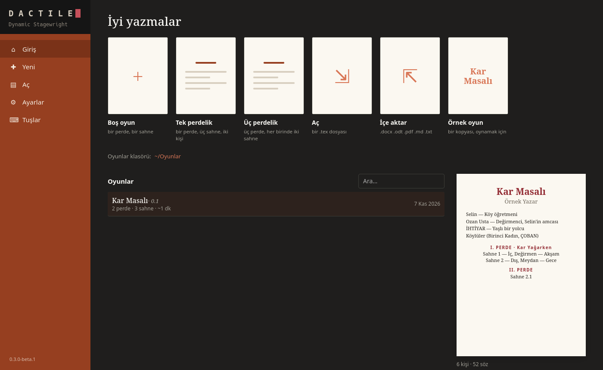

# Getting started

Dactile is an app for writing stage plays. It comes in two forms:

| | Command | How it works |
|---|---|---|
| **Dactile** | `dactile` | A desktop app: a page, a ribbon and the mouse |
| **Dactile Light** | `dactile-light` | The same writer, in a terminal |

Both use the same plays and settings. A play is always a plain `.tex` file: it
opens in any TeX editor and compiles with XeLaTeX.

## Install

On Linux, get the AppImage from
[Releases](https://github.com/D4shwood/dactile/releases):

```sh
chmod +x Dactile-*-x86_64.AppImage
./Dactile-*-x86_64.AppImage
```

On Arch, the AUR's `dactile-bin` gives the `dactile` command, a menu entry and
Dactile Light.

For Dactile Light:

```sh
tar xzf dactile-light-*-x86_64-linux.tar.gz
cd dactile-light-*-x86_64-linux
./dactile-light install
```

`dactile-light uninstall` removes what it added; plays and settings stay.

**Optional:**

- **XeLaTeX for PDFs:** `texlive-xetex` and `texlive-latexextra`, or a full TeX Live.
- **A Turkish Hunspell dictionary for spell checking:** on Arch,
  `paru -S hunspell-tr`. Everything else works without one.



## The first run

The first run asks for the language, the folder your plays live in, your name,
and how the suggestion menu opens. All of it can change later under Settings.

## Your first play

1. On the start screen, choose an empty play or a one-act or three-act skeleton.
   In a terminal: `dactile-light new "Kar Masalı"`.
2. Add a character. Typing an alias nobody declared, such as `\se ` (backslash,
   alias, space), opens the new-character form.
3. Type `#sahne` and fill in the place and time.
4. Start writing:

```latex
#sahne İç, Değirmen — Akşam

\se Amca, yine mi taş durdu?
\oz Durdu kızım. \ic{elini taşa koyar} Soğuk her şeyi durdurur.
```

Dactile saves by itself and keeps earlier versions.

## Your first PDF

**F5** builds the PDF next to the play. In Dactile, **F12** opens the PDF panel.
From the command line:

```sh
dactile-light pdf oyun.tex --open
```

For a Word document: **Home › Export to Word** in Dactile, "Export to Word" on Ctrl+P
in Dactile Light, `dactile-light docx oyun.tex` on the command line. It lands next to
the play; someone else's document of that name stays. Footnotes stay in the text, in
brackets.

If it fails, see [Troubleshooting](troubleshooting.md).

## Next

- [Writing](writing.md): everything that helps as you write
- [Importing](importing.md): bringing in a play written elsewhere
- [examples/ornek-oyun.tex](../../examples/ornek-oyun.tex): a made-up play showing every feature
