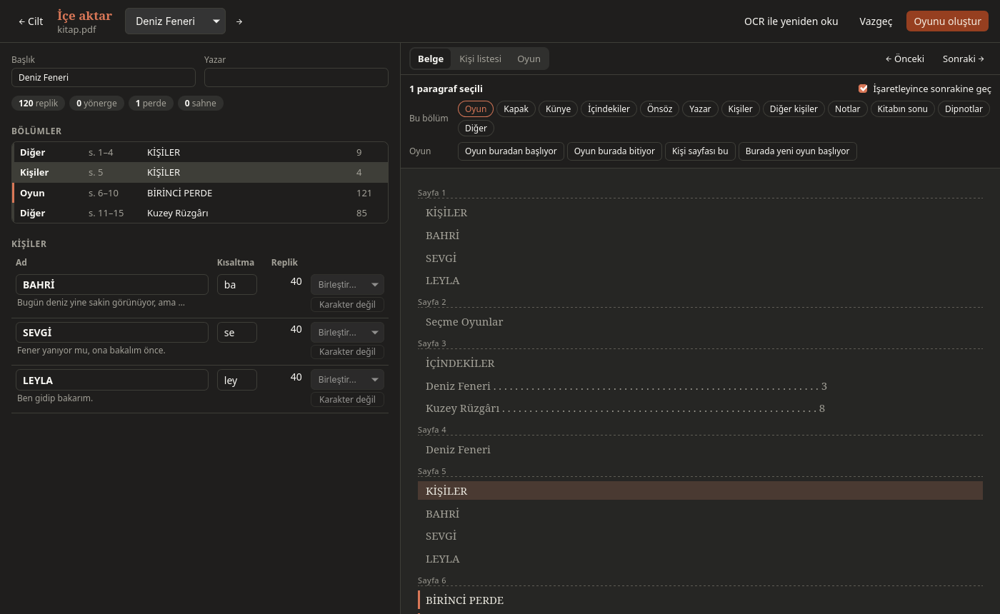
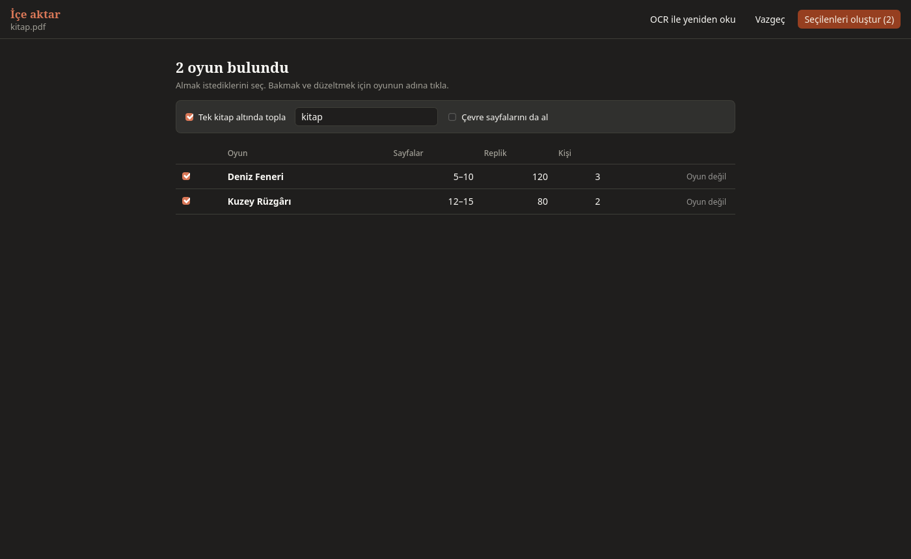

# Importing

A play written elsewhere comes into Dactile as an editable `.tex`.

**Files:** Word `.docx`, LibreOffice `.odt`, PDF, Markdown, plain text.

```sh
dactile-light import oyun.docx
```

## What is found

- The title and author
- A cast list (`KİŞİLER`, `CHARACTERS`) and what it says of each
- Act and scene headings (`BİRİNCİ PERDE`, `2. Sahne: Ahır`, `ACT ONE`)
- Numbered scenes with names (`1. KIYI KAHVESİ`, `2. FENER YOLU`)
- A preface and notes
- Lines: `NAME: …`, `NAME — …`, `NAME. …`, or the name on its own line above
- Directions: paragraphs in parentheses or all in italics; `(laughing)` inside a line
- Footnotes, where the page marks them

In a PDF the running heads and page and line numbers go, and lines the page broke
are joined. Short ones stay as in a poem.

## Scanned PDFs

A PDF with no text in it is read from its page images by itself. Dactile carries
Tesseract and Poppler's tools, so nothing else needs installing. For a PDF whose
text is poor, use **Read again with OCR** in the preview. It clears the parts you
marked.

In Dactile Light, `dactile-light import --ocr` needs Tesseract with Turkish installed.

## The preview

A preview opens before the play is written. On the left: the title, the numbers,
the parts and the people. On the right, three tabs:

- **Document:** The whole text. Click a paragraph or a part on the left, use Shift
  for many, F3 for the next.
- **Cast list:** The list, put right as text.
- **Play:** How the result will read.



A choice brings two rows of tools:

- **This part:** Marks it as the cover, imprint, contents, preface, author, cast,
  notes or end of book.
- **Play:** Says where the play starts or ends, that this is the cast page or a scene
  heading, or that a new play starts here. **Scene heading** marks one that was missed,
  **Not a scene heading** takes back a wrong one. In Dactile Light, `h` and `H`.

In the people table you can change a name or alias, merge two names for one person,
and mark one as "Not a character". Its lines stay as text.

## Books of several plays

A volume is told by its contents and title pages. Without them Dactile looks at who
speaks, and a play found that way is marked as a **guess**.

The volume opens on a list of its plays with their pages, lines and people:



1. Tick those to take.
2. Click a play's name to look it over. **← Volume** goes back.
3. On a play found wrongly, press **Not a play**: its text joins the one before.
4. Press **Make the chosen**. An existing file is never overwritten; a new name is taken.

```sh
dactile-light import cilt.pdf --all            # all of them
dactile-light import cilt.pdf --play "Kar"     # the play with "Kar" in its title
```

## Gathering under one book

**Gather them under one book** on the volume screen puts the plays under a book.
**Take the pages around them too** brings the introduction, a chronology and the
like into the book's own file. It is off by default.

```sh
dactile-light import cilt.pdf --all --book "Seçme Oyunlar" --front
```

A book is a tree on Dactile's start screen. Plays you already have can be gathered
into one too, by choosing several.

The book's PDF has a cover, the contents and every play, named `<book>-kitap.pdf`.
In Dactile, right click the book. In a terminal:

```sh
dactile-light book kitap.tex
```

## The cast list

Where a book's cast page is unusual, choose it under Document, press **This is the
cast page**, then put it right under **Cast list**. A person a line:

```text
SELİN | a village teacher
TEACHER SELİN = SELİN | when the list names her differently
\chargroup Villagers
\gkarakter ÇOBAN | an old shepherd
+ musicians, soldiers
# this line is a comment
```

| Line | Means |
|---|---|
| `NAME \| note` | A person and a note on them |
| `NAME ON THE LIST = NAME OVER THE LINES \| note` | Where the two differ |
| `\chargroup Name` | A group's heading |
| `\gkarakter NAME \| note` | A person in the group |
| `+ …` | Those named only together |
| `# …` | A comment |

Under the list stand two checks: **listed, never speaks** and **speaks, not listed**.
