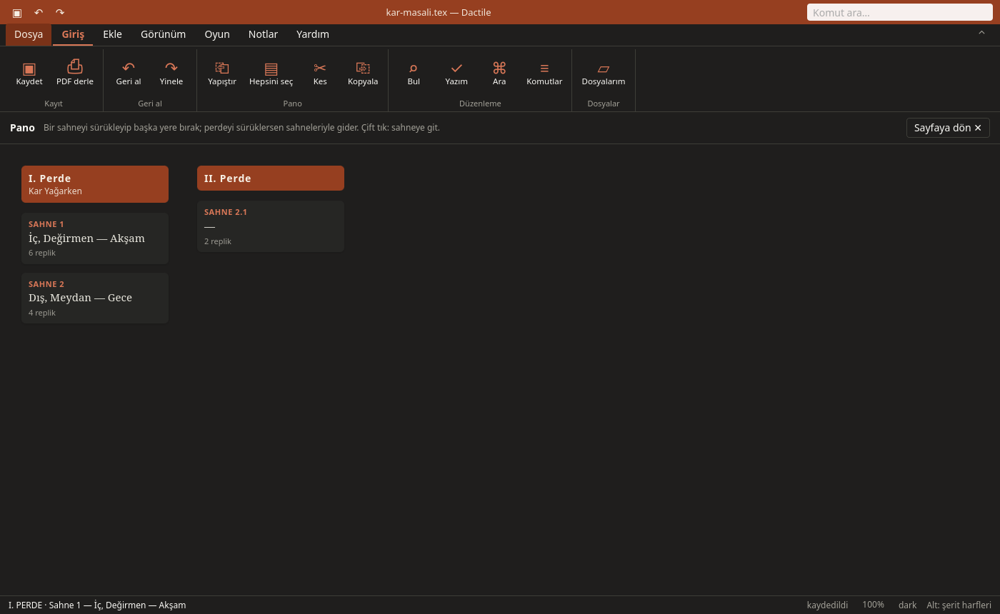

# Getting it staged

Once the play is written, Dactile helps with rehearsals too.

## The board

**Ctrl+G** opens the board. In Dactile Light, once gives the scene strip beside the
writing and twice quickly the full-screen board; Tab goes between list and cards.



- ⏎ goes to the scene, `e` writes its summary. A summary is never printed.
- Alt+↑↓ moves a scene. `m` picks it up, the arrows choose where, ⏎ puts it down.
- `j` joins it with the next; Alt+B in the writer splits it at the cursor.
- `n` opens a hidden scene: out of the PDF until ⏎ opens it to write in.
- `h` hides, `t` moves to the play's trash, `c` shows the trash.

Before a session's first move, the play as it was is kept as a draft beside it.

## Casting

**F9** opens three views:

- **Casting:** Roles, their actors, lines and times. A play can have several
  castings, an A and a B lineup.
- **Table:** Scenes by roles. ● speaks, ○ on stage without a line. `x` writes CSV,
  `p` a landscape PDF.
- **Numbers:** Lengths by role, scene and act. `w` sets the pace in words a minute.

Actors' names never reach the play's own PDF.

## Actor copies

`k` under casting builds a PDF for each actor, in `oyun-kopyalar/`:

| | |
|---|---|
| **Full** | Their lines in bold, the rest faint, the scenes they are not in down to headings |
| **Rehearsal** | Room for notes where the others' words were |
| **Rehearsal light** | The first one to three words of each of the others' lines |

The cover has the actor's name, their scenes with pages, and how much they say.

## Memorizing

`z` under casting shows the cues before each of the role's lines and hides the line.
Space shows the first letters of its words, then all of it, then goes on.

## Notes

Notes from a workshop, a reader or an AI live beside the play in `oyun.notlar.md`,
a Markdown task list that editors such as Obsidian read too:

```text
## Spelling

- [ ] 139 · **Workshop** · “Gaztesi” → Gazetesi
  - **Deniz**: the same in act two
- [x] 20 · **Reader** · “loş bir bir ışığın”: “bir” twice
```

`[ ]` is open, `[x]` done, `[-]` hidden. A note finds its place by what it quotes, so
lines added above it don't lose it.

**Ctrl+N** opens the panel. In Dactile Light:

| Key | |
|---|---|
| `p`, `i` | Paste a reply, take a file of notes; each numbered item is a note |
| `n` | A note of your own |
| ␣ | Done, or open again |
| `u` | Make the note's correction, `“wrong” → right`; Ctrl+Z undoes it |
| `r`, `e` | Reply, edit |
| `h`, `a`, `x` | Hide, archive, delete (twice) |
| `c`, `o` | A PDF copy with the notes (`oyun - notlu.pdf`), open it |

Nothing changes the play by itself.
