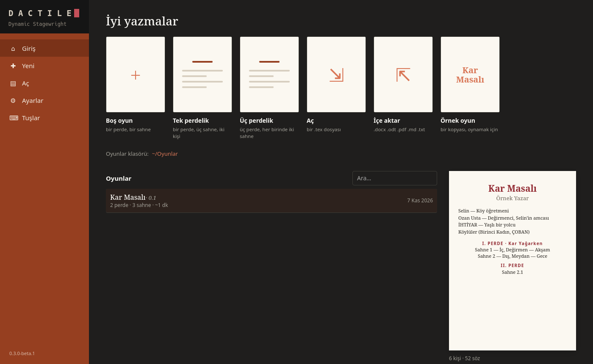

# Başlangıç

Dactile sahne oyunu yazmak için bir uygulamadır. İki biçimi vardır:

| | Komut | Nasıl çalışır |
|---|---|---|
| **Dactile** | `dactile` | Masaüstü uygulaması: sayfa, şerit ve fare |
| **Dactile Light** | `dactile-light` | Aynı yazar, terminalde |

İkisi de aynı oyunları, aynı ayarları kullanır. Oyun her zaman düz bir `.tex`
dosyasıdır: başka bir TeX düzenleyicisinde de açılır, XeLaTeX ile derlenir.

## Kurulum

Linux'ta [Releases](https://github.com/D4shwood/dactile/releases) sayfasından
AppImage'ı indir:

```sh
chmod +x Dactile-*-x86_64.AppImage
./Dactile-*-x86_64.AppImage
```

Arch'ta AUR'daki `dactile-bin` paketi `dactile` komutunu, menü kaydını ve
Dactile Light'ı kurar.

Dactile Light için:

```sh
tar xzf dactile-light-*-x86_64-linux.tar.gz
cd dactile-light-*-x86_64-linux
./dactile-light install
```

`dactile-light uninstall` kurulanları kaldırır; oyunlar ve ayarlar kalır.

**İsteğe bağlı olanlar:**

- **PDF için XeLaTeX:** `texlive-xetex` ve `texlive-latexextra`, ya da tam TeX Live.
- **Yazım denetimi için Türkçe Hunspell sözlüğü:** Arch'ta `paru -S hunspell-tr`.
  Sözlük yoksa geri kalan her şey çalışır.



## İlk açılış

İlk açılışta dil, oyunların duracağı klasör, adın ve öneri menüsünün nasıl
açılacağı sorulur. Bunların hepsi sonradan Ayarlar'dan değişir.

## İlk oyun

1. Başlangıç ekranında boş oyunu, tek perdelik ya da üç perdelik iskeleti seç.
   Dactile Light'ta aynısı: `dactile-light new "Kar Masalı"`.
2. Bir kişi ekle. Tanımlı olmayan bir kısaltma yazınca, örneğin `\se ` (ters
   bölü, kısaltma, boşluk), yeni kişi formu açılır.
3. `#sahne` yaz, yeri ve zamanı doldur.
4. Yazmaya başla:

```latex
#sahne İç, Değirmen — Akşam

\se Amca, yine mi taş durdu?
\oz Durdu kızım. \ic{elini taşa koyar} Soğuk her şeyi durdurur.
```

Dactile kendiliğinden kaydeder. Eski sürümleri de saklar.

## İlk PDF

**F5** PDF'i oyunun yanına derler. Dactile'da **F12** PDF panelini açar.
Komut satırından:

```sh
dactile-light pdf oyun.tex --open
```

Word belgesi için Dactile'da **Giriş › Word olarak ver**, Dactile Light'ta Ctrl+P
ile "Word olarak ver", komut satırında `dactile-light docx oyun.tex`. Belge oyunun
yanına yazılır; başkasının aynı adlı belgesi ezilmez. Dipnotlar köşeli parantezle
metinde kalır.

Hata çıkarsa [Sorun giderme](sorun-giderme.md) sayfasına bak.

## Sonra

- [Yazmak](yazmak.md): yazarken işe yarayan her şey
- [İçe aktarma](ice-aktarma.md): başka yerde yazılmış bir oyunu getirmek
- [examples/ornek-oyun.tex](../../examples/ornek-oyun.tex): bütün özellikleri gösteren uydurma bir oyun
