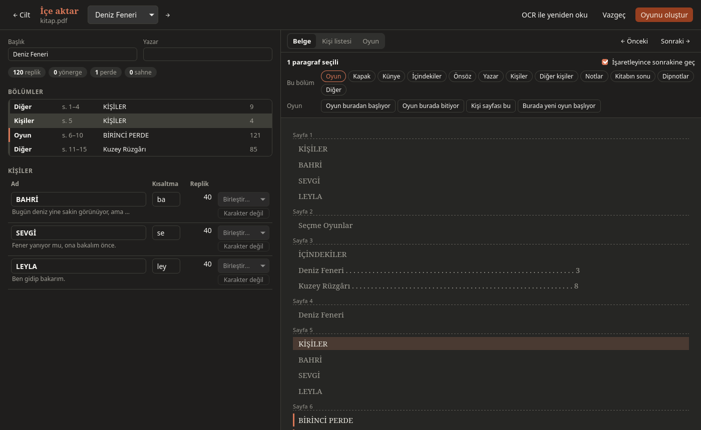
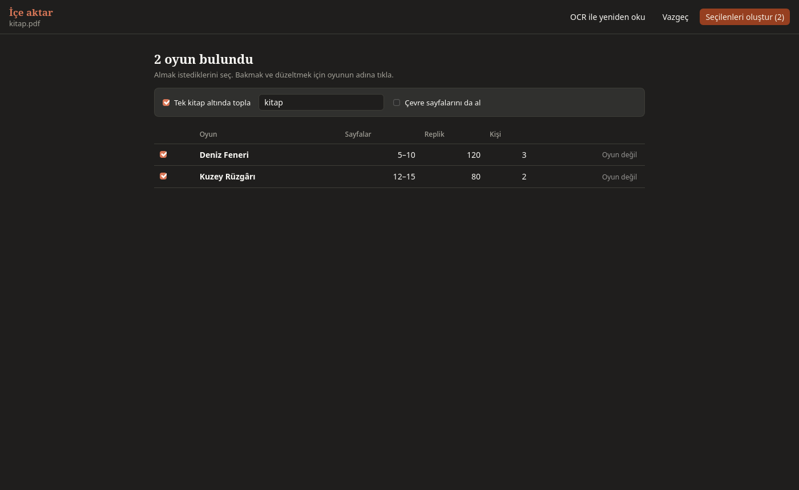

# İçe aktarma

Başka yerde yazılmış bir oyun Dactile'a gelir ve düzenlenebilir bir `.tex` olur.

**Desteklenen dosyalar:** Word `.docx`, LibreOffice `.odt`, PDF, Markdown, düz metin.

```sh
dactile-light import oyun.docx
```

## Ne bulunur

- Başlık ve yazar
- Kişi listesi (`KİŞİLER`, `CHARACTERS`) ve kişiler hakkında yazılanlar
- Perde ve sahne başlıkları (`BİRİNCİ PERDE`, `2. Sahne: Ahır`, `ACT ONE`)
- Adı olan numaralı sahneler (`1. KIYI KAHVESİ`, `2. FENER YOLU`)
- Önsöz ve notlar
- Replikler: `AD: …`, `AD — …`, `AD. …` ya da ad üstte ayrı satırda
- Yönergeler: parantezli ya da tamamı italik paragraflar; replik içinde `(gülerek)`
- Dipnotlar, sayfada işaretlendikleri yerde

PDF'te sayfa başlıkları, sayfa ve satır numaraları atılır, sayfanın böldüğü
satırlar birleştirilir. Kısa satırlar şiirdeki gibi kalır.

## Taranmış PDF

İçinde metin olmayan bir PDF sayfa görüntülerinden kendiliğinden okunur. Dactile
Tesseract'ı ve Poppler araçlarını içinde taşır, başka bir şey kurmak gerekmez.
Metni kötü bir PDF için önizlemedeki **OCR ile yeniden oku** düğmesini kullan.
Bu düğme işaretlediğin bölümleri sıfırlar.

Dactile Light'ta `dactile-light import --ocr` için Tesseract ve Türkçe modelinin
kurulu olması gerekir.

## Önizleme

Oyun yazılmadan önce önizleme açılır. Solda başlık, sayılar, bölümler ve kişiler,
sağda üç sekme vardır:

- **Belge:** Bütün metin. Bir paragrafa ya da soldaki bir bölüme tıkla, Shift ile
  toplu seç, F3 ile sonrakine geç.
- **Kişi listesi:** Listeyi metin olarak düzeltirsin.
- **Oyun:** Sonucun nasıl görüneceği.



Seçim yapınca iki satır araç çıkar:

- **Bu bölüm:** Seçimi kapak, künye, içindekiler, önsöz, yazar, kişiler, notlar ya
  da kitabın sonu olarak işaretler.
- **Oyun:** Oyunun başladığı ve bittiği yeri, kişi sayfasını, sahne başlığını ya da
  burada yeni bir oyun başladığını söyler. **Sahne başlığı** kaçırılan bir başlığı
  işaretler, **Sahne başlığı değil** yanlış bulunanı kaldırır. Dactile Light'ta `h` ve `H`.

Kişiler tablosunda adı ve kısaltmayı değiştirebilir, aynı kişi olan iki adı
birleştirebilir, yanlışlıkla ad sanılanı "Karakter değil" diye işaretleyebilirsin.
O satırlar düz metin kalır.

## Birden çok oyunlu kitaplar

Cilt, içindekiler ve başlık sayfalarından tanınır. Bunlar yoksa kimin konuştuğuna
bakılır; böyle bulunan oyun **tahmin** diye işaretlenir.

Cilt, oyunların sayfa, replik ve kişi sayılarıyla bir listede açılır:



1. Almak istediklerini işaretle.
2. Bakmak ve düzeltmek için oyunun adına tıkla. **← Cilt** listeye döner.
3. Yanlış bulunan oyunda **Oyun değil** de: metni bir öncekine katılır.
4. **Seçilenleri oluştur** de. Var olan dosyanın üstüne yazılmaz, yeni ad alınır.

```sh
dactile-light import cilt.pdf --all            # hepsi
dactile-light import cilt.pdf --play "Kar"     # başlığında "Kar" geçen oyun
```

## Tek kitap altında toplamak

Cilt ekranında **Tek kitap altında topla** seçeneği, oyunları bir kitabın altına
alır. **Çevre sayfalarını da al** seçeneği giriş, kronoloji gibi sayfaları kitabın
kendi dosyasına koyar. Bu seçenek varsayılan olarak kapalıdır.

```sh
dactile-light import cilt.pdf --all --book "Seçme Oyunlar" --front
```

Kitap, Dactile'ın başlangıç ekranında ağaç gibi görünür. Var olan oyunları da
çoklu seçimle bir kitapta toplayabilirsin.

Kitabın PDF'i kapak, içindekiler ve bütün oyunlardan oluşur, adı `<kitap>-kitap.pdf`
olur. Dactile'da oyuna sağ tıkla, Light'ta:

```sh
dactile-light book kitap.tex
```

## Kişi listesi yazımı

Kitaptaki kişi sayfası sıra dışıysa Belge'de seçip **Kişi sayfası bu** de, sonra
**Kişi listesi** sekmesinde düzelt. Her satırda bir kişi:

```text
SELİN | köy öğretmeni
ÖĞRETMEN SELİN = SELİN | listedeki ad farklıysa
\chargroup Köylüler
\gkarakter ÇOBAN | yaşlı bir çoban
+ müzisyenler, askerler
# bu satır yorumdur
```

| Satır | Anlamı |
|---|---|
| `AD \| not` | Kişi ve hakkındaki not |
| `LİSTEDEKİ AD = REPLİKTEKİ AD \| not` | Listede ve replikte ad farklıysa |
| `\chargroup Ad` | Grup başlığı |
| `\gkarakter AD \| not` | Gruptaki kişi |
| `+ …` | Yalnızca toplu anılanlar |
| `# …` | Yorum |

Liste altında iki denetim vardır: **listede ama hiç konuşmuyor** ve **konuşuyor ama
listede yok**.
