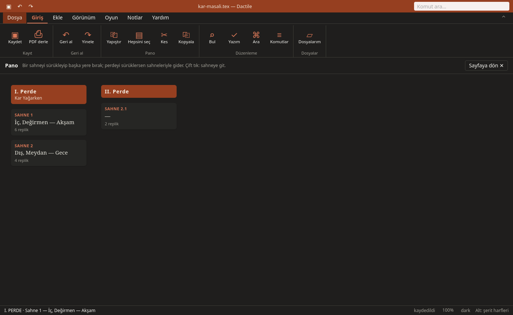

# Sahneye hazırlık

Oyun bitince Dactile provaya da hazırlar.

## Pano

**Ctrl+G** panoyu açar. Dactile Light'ta bir kez basmak yanda sahne şeridini,
çabuk iki kez basmak tam ekran panoyu açar; Tab liste ve kartlar arasında geçer.



- ⏎ sahneye gider, `e` özetini yazar. Özet PDF'e girmez.
- Alt+↑↓ sahneyi taşır. `m` alır, oklar yer seçer, ⏎ bırakır.
- `j` sonrakiyle birleştirir; Alt+B yazarken sahneyi imleçten böler.
- `n` gizli sahne açar: ⏎ ile yazıya açılana kadar PDF'e girmez.
- `h` gizler, `t` oyunun çöpüne atar, `c` çöpü gösterir.

Oturumun ilk taşımasından önce oyunun o anki hâli taslak olarak yanına saklanır.

## Dağıtım

**F9** üç görünüm açar:

- **Dağıtım:** Roller, oyuncuları, replikleri, süreleri. Bir oyunun A ve B gibi
  birden çok dağıtımı olabilir.
- **Tablo:** Sahneler ve roller. ● konuşuyor, ○ sahnede ama sessiz. `x` CSV, `p`
  yatay PDF yazar.
- **Sayılar:** Rol, sahne ve perde uzunlukları. `w` dakikadaki kelime hızını ayarlar.

Oyuncu adları oyunun PDF'inde asla görünmez.

## Oyuncu kopyaları

Dağıtımda `k` her oyuncuya ayrı PDF üretir (`oyun-kopyalar/` klasörüne):

| | |
|---|---|
| **Tam** | Oyuncunun replikleri kalın, geri kalanı soluk, olmadığı sahneler yalnızca başlık |
| **Prova** | Ötekilerin sözleri yerine not alacak boşluk |
| **Hafif prova** | Ötekilerin her repliğinin ilk bir iki üç kelimesi |

Kapakta oyuncunun adı, sahneleri ve sayfaları ile ne kadar konuştuğu yazar.

## Ezber

Dağıtımda `z`: rolün her repliğinden önceki ipuçlarını gösterir, repliği gizler.
Boşluk önce kelimelerin baş harflerini, sonra tamamını gösterir, sonra ilerler.

## Notlar

Bir atölyeden, okurdan ya da yapay zekâdan gelen notlar oyunun yanında
`oyun.notlar.md` dosyasında durur. Bu dosya Markdown görev listesidir, Obsidian gibi
düzenleyicilerle de açılır:

```text
## Yazım

- [ ] 139 · **Atölye** · “Gaztesi” → Gazetesi
  - **Deniz**: ikinci perdede de aynısı
- [x] 20 · **Okur** · “loş bir bir ışığın”: “bir” iki kez
```

`[ ]` açık, `[x]` tamam, `[-]` gizli demektir. Not, alıntıladığı metne bakarak
yerini bulur; üstüne satır eklemek notu kaybettirmez.

**Ctrl+N** paneli açar. Dactile Light'ta panelde:

| Tuş | |
|---|---|
| `p`, `i` | Yanıt yapıştır, dosyadan not al; numaralı her madde not olur |
| `n` | Kendi notun |
| ␣ | Tamam ya da yeniden açık |
| `u` | Notun düzeltmesini uygula, `“yanlış” → doğru`; Ctrl+Z geri alır |
| `r`, `e` | Yanıtla, düzenle |
| `h`, `a`, `x` | Gizle, arşivle, sil (iki kez) |
| `c`, `o` | Notlu PDF kopyası (`oyun - notlu.pdf`), aç |

Notlar oyunu kendiliğinden değiştirmez.
