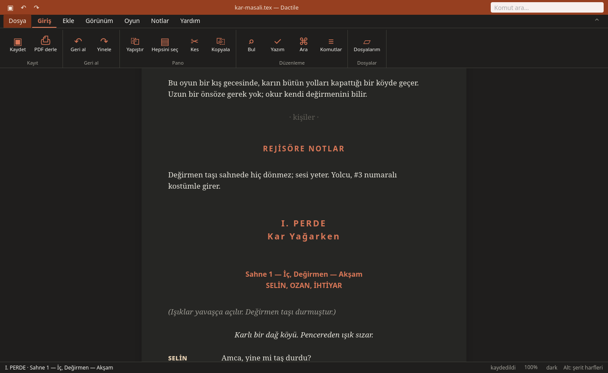
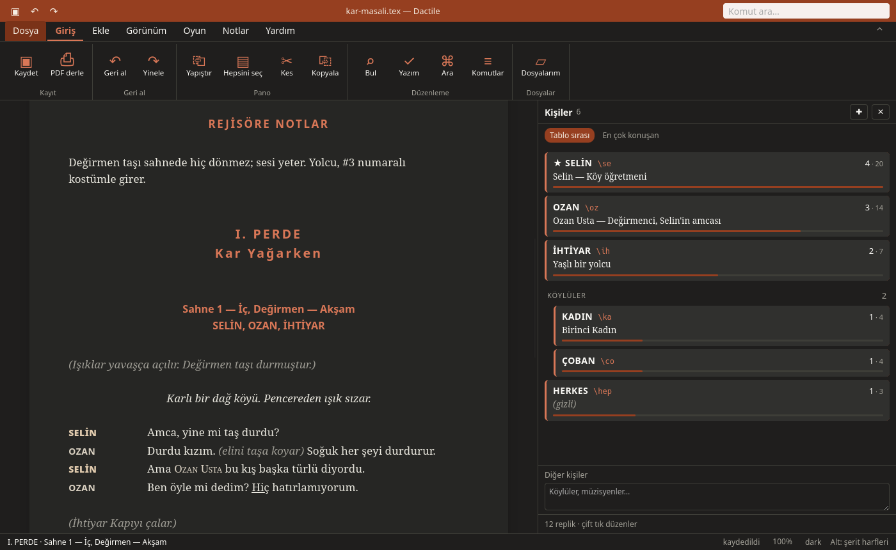
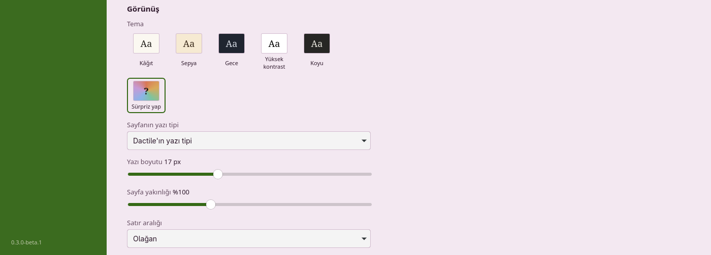

# Yazmak

Oyun, [tiyatro sınıfının](tiyatro-sinifi.md) yazımıyla yazılır. Yazdıkça
komutlar canlanır: `\se Amca` hemen `SELİN   Amca` olur.



## Kişiler

Her kişinin bir adı ve bir kısaltması vardır:

```latex
\karakter*[Selin][Köy öğretmeni]{SELİN}{se}
\karakter[Ozan Usta][Değirmenci]{OZAN}{oz}
```

- `{SELİN}`: replik üstünde görünen ad.
- `{se}`: yazarken kullandığın kısaltma, `\se`.
- `*`: kişi son sürümün kapağında görünür.

Kişileri kişiler panelinden (**Ctrl+O**) yönetmek daha kolaydır: düzenleme,
kısaltmayı her yerde değiştirme, sıralama, kişi kartları. Dactile Light'ta aynı
panelde `m` iki kişiyi birleştirir, `b` birini seçtiğin sahnelerle ikiye ayırır,
`g` yeni grup açar.



## Replik ve yönerge

| Yaz | Sonuç |
|---|---|
| `\se ` | SELİN'in repliği; tanımsız kısaltma yeni kişi formunu açar |
| `\sedo ` | Yönerge, `(Selin …)`, bu oyunda en çok kullanılan fiilleri önerir |
| `\` | Öneri menüsü: kişiler (sahnedekiler önce), komutlar, makrolar |
| `SELİN:` satır başında | SELİN'in repliği, adın herhangi bir biçimiyle |
| Boş satırda Tab | Sıradaki konuşmacı: son konuşandan öncekinin adı soluk görünür |
| `((` | Replik içinde yönerge, `\ic{…}` |
| Satır başında Ctrl+V | Dışarıdan yapıştırılan taslak: `AD: …` replik, `(…)` yönerge, `#…` başlık olur |

Replik, altındaki satırlara boş satıra kadar devam eder; her kaynak satırı
baskıda da kendi satırıdır. Bu yüzden şiir ve şarkı için ek bir şey gerekmez.

## Başlıklar

Satır başındaki `#` başlık menüsünü açar:

| Yaz | Ne yapar |
|---|---|
| `#perde Kar Yağarken` | Perde |
| `#sahne İç, Değirmen — Akşam` | Numaralı sahne |
| `#önsahne Yer` | Numarasız ön sahne; sonraki `#sahne` yine 1 olur |
| `#önsöz` | Önsöz, kendi sayfasında |
| `#notlar` | Yönetmene notlar, kendi sayfasında |

Sahnede kim varsa başlığının altında kendiliğinden toplanır.

## Görünüm

**F6** temayı değiştirir: kâğıt, sepya, gece, yüksek kontrast, koyu. Dactile'da
Ayarlar'daki **Sürpriz yap** düğmesi her basışta yeni renkler üretir. Vurgu
rengi, yazı tipi, boyut, satır aralığı ve sayfa genişliği de oradadır.



**F7** A4 sayfa görünümüdür: sayfalar PDF'in kırıldığı yerde kırılır.

## Tuşlar

Her iki uygulamada:

| Tuş | |
|---|---|
| Ctrl+S | Kaydet (kendiliğinden de kaydeder) |
| F2 | Bütün kaynak |
| F3, F4, F8 | Daktilo, sahne odağı, geri kalanı soldur |
| F5 | PDF derle |
| F6, F7 | Tema, sayfa görünümü |
| F9 | Dağıtım, tablo, sayılar |
| Ctrl+G | Pano |
| Ctrl+K | Kişi ve komut menüsü |
| Ctrl+N, Alt+N | Notlar paneli; seçili yere not |
| Ctrl+O | Kişiler |
| Alt+E | Sahnenin özeti (PDF'e girmez) |
| Alt+B, Alt+J | Sahneyi imleçte böl; sonrakiyle birleştir |
| Alt+S | Yazım önerileri |

Yalnızca Dactile'da: **F12** PDF paneli, **Ctrl + / − / 0** sayfa yakınlığı,
**Ctrl+F1** şeridi katla, **Alt** şerit harfleri.

Yalnızca Dactile Light'ta: **F10** şerit, **Ctrl+P** komut paleti, **F1**
her tuşun ne yaptığını gösteren klavye.

## Başlangıç ekranı

Dactile'da **Shift** ve **Ctrl** birkaç oyunu seçer. Oyuna **sağ tıklamak** şunları
açar: aç, adını değiştir, kopya, yeni taslak, dosya gezgininde göster, çöpe at.
Kitap olan oyunlarda kitabın PDF'i de buradadır.

Dactile Light'ta oyun listesinde `d` kopyalar, `f` yeni taslak açar, F2 adını
değiştirir, `p` PDF'i açar. Del iki kez basılınca çöpe atar, `u` geri getirir.
`?` bütün tuşları listeler.

Taslaklar oyunun yanında durur: `kar-masali-0.2.tex`.
